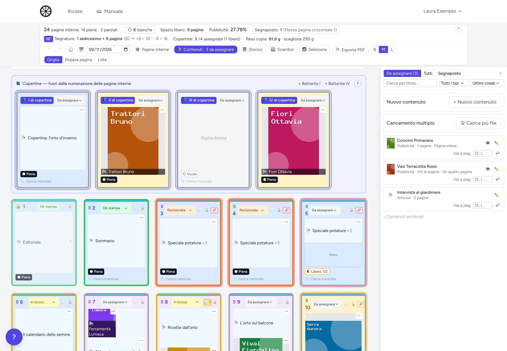
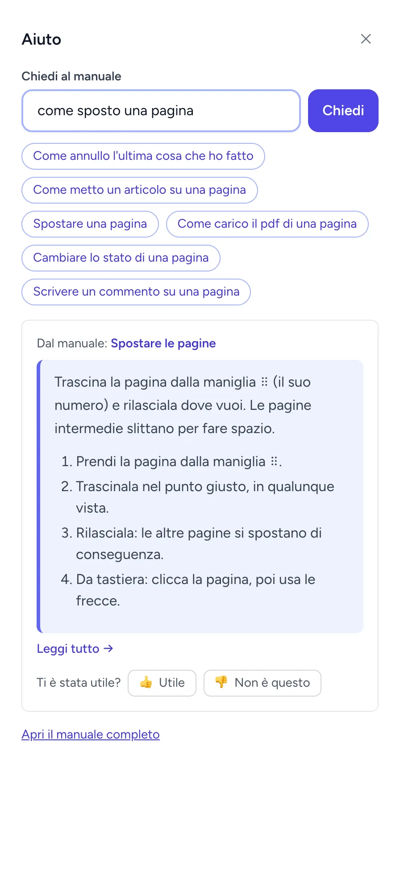
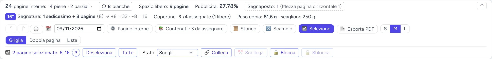
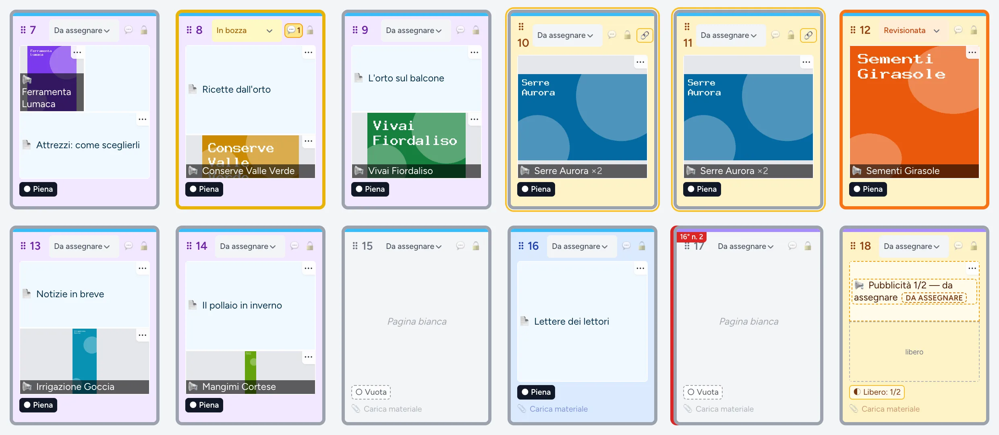
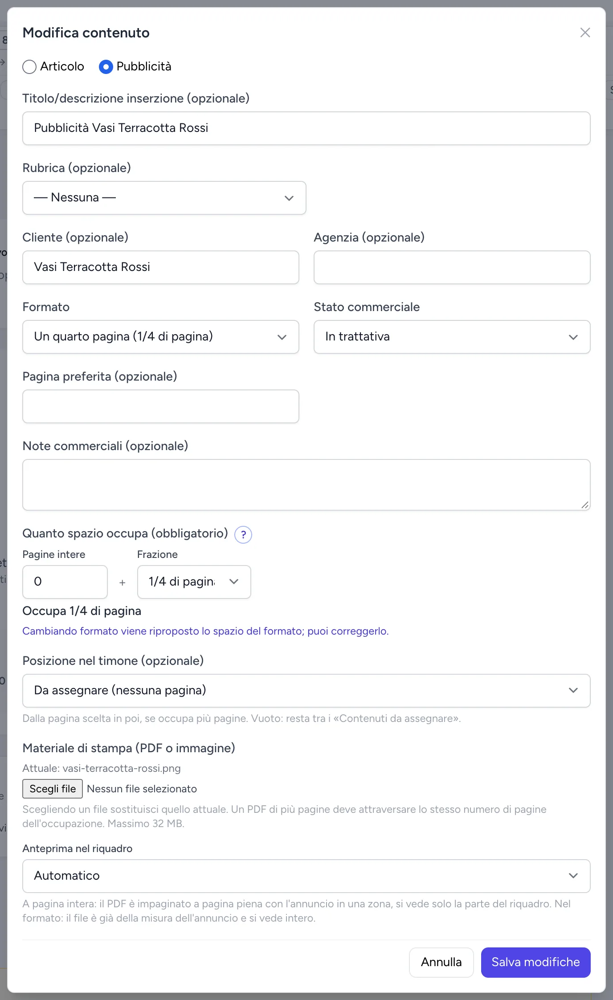
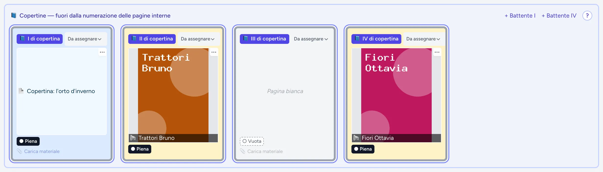
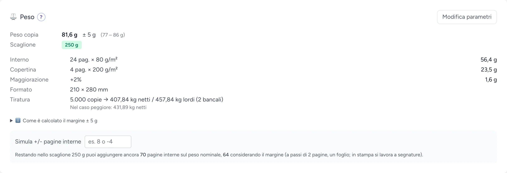
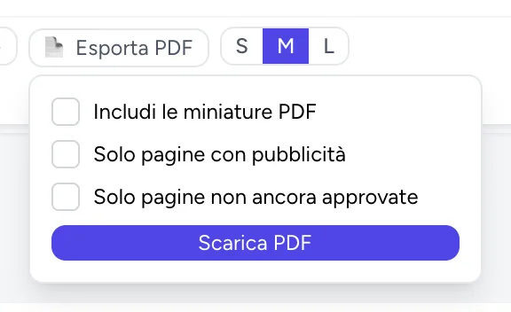
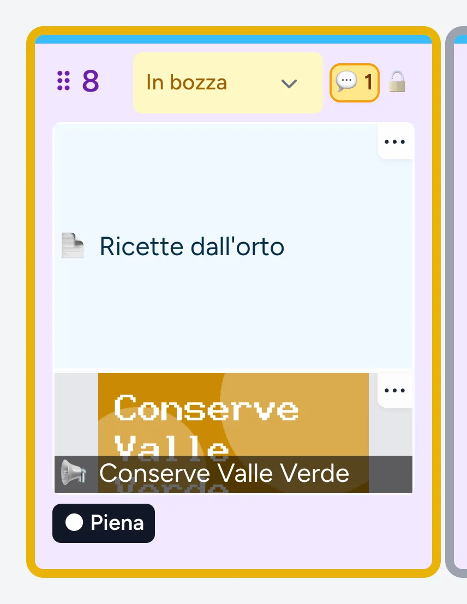

<!-- File generato da «php artisan manuale:genera»: NON modificare a mano.
     Le pagine del manuale sono in resources/manuale/ (una per argomento). -->

# Manuale utente — Timone Elettronico

Il manuale si legge anche nell'applicazione, dalla voce «📖 Manuale» nel menu in alto, una pagina per argomento.

## Inizia qui

### Inizia qui

**In breve**

Il timone è la pianificazione delle pagine di una rivista: vedi quali pagine sono occupate da articoli o pubblicità, quali sono libere, e le sposti insieme ai colleghi. La struttura è sempre **rivista → numero → timone**.

1. Apri <{{APP_URL}}> e entra con l'email e la password che ti hanno dato.
2. In «Le tue riviste» scegli la rivista.
3. Scegli il numero: si apre il suo timone.
4. Per i compiti più comuni parti da [Cosa vuoi fare?](resources/manuale/cosa-vuoi-fare.md). Per una domanda, il bottone **?** in basso a sinistra.

#### Rivista, numero, timone

- Una **rivista** è la testata, per esempio «Motori Elettrici».
- Un **numero** è una singola uscita della rivista, per esempio «Novembre 2026». Ha un numero di pagine deciso.
- Il **timone** è la griglia delle pagine di un numero. Qui si fa il lavoro vero e proprio.

#### Entrare

Accedi da <{{APP_URL}}>. È l'indirizzo della tua installazione: nella pagina «📖 Manuale» dell'app compare quello vero. Usa l'email e la password che ti sono state assegnate. Se non hai ancora un account, chiedi a un Admin di crearlo: vedi [Gestire gli utenti](resources/manuale/utenti.md).

Quello che vedi e puoi fare dipende dal tuo **ruolo**: vedi [Chi può fare cosa](resources/manuale/ruoli.md).

#### La schermata del timone

1. Il **riepilogo** del numero: pagine piene e libere, pubblicità, segnature, peso.
2. La **fascia dei comandi**: annulla, scadenza stampa, **⚙️ Pagine interne**, **📚 Contenuti**, **🔀 Scambio**, **☑️ Selezione**, **📄 Esporta PDF**, zoom S/M/L.
3. Le **viste**: Griglia, Doppia pagina, Lista.
4. Le **copertine** I–IV, fuori dalla numerazione delle pagine interne.
5. Una **pagina**: trascinala dalla maniglia ⠿ per spostarla.
6. Il **pannello Contenuti**: articoli e pubblicità da mettere sulle pagine.
7. Il bottone **?**: chiedi al manuale.

#### Dove trovare questo manuale

Il manuale è anche **dentro l'applicazione**, senza uscire dal browser: voce **«📖 Manuale»** nel menu in alto. Ogni argomento ha una sua pagina. Per trovare quello che ti serve scrivi nel campo **«Cerca nel manuale»** in alto (premi `/` o Ctrl+K, ⌘+K su Mac, per andarci da qualunque punto): i risultati compaiono mentre scrivi, frecce per sceglierne uno, Invio per aprirlo. Oppure usa l'**indice cliccabile** delle categorie. Non serve leggerlo tutto di fila.

Se preferisci fare una domanda, clicca il bottone tondo **?** in basso a sinistra, da qualunque schermata: vedi [Chiedi al manuale](resources/manuale/chiedi-al-manuale.md).

**Dettagli**

- Nell'indice, «Mostrami le pagine per» mette in evidenza le pagine del tuo ruolo; «Mostra tutto» riporta le altre. Accanto alla pagina aperta, «In questa pagina» elenca le sue sezioni ed evidenzia quella che stai leggendo.
- Il simbolo # accanto a un titolo copia il link a quella sezione, da mandare a un collega. Il bottone «↑ Torna su» riporta in cima. Stampando una pagina, i «Dettagli» si stampano aperti.
- La ricerca capisce anche parole simili (togliere, rimuovere, eliminare) e qualche errore di battitura. Se non trova nulla propone parole vicine e i compiti più frequenti.
- L'indirizzo è `/manuale`. Il vecchio indirizzo `/documentazione` ti porta comunque lì.
- I vecchi link a una sezione del manuale (per esempio `#9ter-peso-della-rivista`) portano alla pagina nuova dello stesso argomento.
- Se al posto del manuale compare un avviso giallo, vedi [Problemi frequenti](resources/manuale/problemi-frequenti.md).

#### Vedi anche

- [Cosa vuoi fare?](resources/manuale/cosa-vuoi-fare.md)
- [Le viste del timone](resources/manuale/viste-del-timone.md)
- [Chi può fare cosa](resources/manuale/ruoli.md)
- [Glossario](resources/manuale/glossario.md)

### Chiedi al manuale

**In breve**

Scrivi la tua domanda con le tue parole: l'assistente ti mostra il riquadro «In breve» della pagina del manuale che risponde.

1. Clic sul bottone tondo **?** in basso a sinistra, da qualunque schermata (o usa il riquadro «Chiedi al manuale» nella pagina del Manuale).
2. Scrivi la domanda e premi **Chiedi** (o Invio). Oppure clicca una delle domande pronte.
3. Leggi la risposta; **«Leggi tutto →»** apre la pagina intera.
4. Di' se è servita: **👍 Utile** o **👎 Non è questo**. Con 👎 compaiono altre tre pagine: se una è quella giusta, clicca **«👍 È questa»**.

Accanto ad alcuni comandi c'è anche una piccola **?** tonda: apre la pagina del manuale su quel comando in una nuova scheda.

1. Scrivi la domanda e premi **Chiedi**.
2. Oppure clicca una domanda pronta.
3. La risposta: il riquadro «In breve» della pagina giusta.
4. **👍 Utile** o **👎 Non è questo**.

#### Cosa risponde

La risposta è sempre il riquadro «In breve» di una pagina di questo manuale: l'assistente non scrive testi suoi, sceglie la pagina. Se non è sicuro mostra **«Non sono sicuro. Forse cercavi:»** con tre pagine; apri quella che ti sembra giusta con un clic sul titolo. Se non trova nulla ti suggerisce di riformulare e alcuni compiti da cui partire.

Dalla schermata in cui sei l'assistente capisce un po' l'argomento: dal timone, per esempio, preferisce le pagine sul timone.

> **Suggerimento**
>
> Usa le parole che vedi sullo schermo, per esempio il nome di un bottone («Pagine interne», «Scambio»): l'assistente le riconosce meglio.

#### Il punto interrogativo accanto ai comandi

Accanto ai comandi meno ovvi c'è una piccola **?** tonda: apre la pagina del manuale che li spiega **in una nuova scheda**, quindi quello che stavi facendo (un modulo a metà, le pagine selezionate) resta com'era. Chiudi la scheda per tornare al timone.

Le trovi accanto a:

- **⚖️ Peso**, nel titolo del pannello: [Peso della rivista](resources/manuale/peso.md).
- la barra delle pagine selezionate: [Selezionare più pagine](resources/manuale/selezione-multipla.md).
- il messaggio «Modalità scambio attiva»: [Scambiare due pagine](resources/manuale/scambiare-pagine.md).
- «Modifica pagine interne», dopo aver cliccato **⚙️ Pagine interne**: [Aggiungere o togliere pagine](resources/manuale/pagine-interne.md).
- **+ Battente I** / **+ Battente IV** e **− Togli battente**, nella fascia delle copertine: [I battenti](resources/manuale/copertine.md).
- «Quanto spazio occupa», nelle finestre di creazione e modifica di un contenuto: [Spazio occupato](resources/manuale/spazio-occupato.md).

Con la tastiera ci arrivi con Tab e la apri con Invio.

#### I tuoi voti

Ogni risposta si vota una volta. I voti di più colleghi insieme aiutano l'assistente a scegliere meglio le risposte la volta dopo: un voto da solo non cambia nulla. Il voto non è legato al tuo nome.

**Dettagli**

- Contano solo i voti dati con i bottoni: l'assistente non guarda cosa clicchi né quanto leggi.
- Un voto conta di più se hai scelto tu la pagina giusta dopo «Non è questo».
- I voti vecchi contano sempre meno e dopo 12 mesi vengono cancellati.
- Le risposte che sappiamo giuste non possono essere peggiorate dai voti: prima di usare quello che ha imparato, l'assistente controlla di rispondere ancora bene a tutte le domande di prova.

#### Vedi anche

- [Inizia qui](resources/manuale/inizia-qui.md)
- [Cosa vuoi fare?](resources/manuale/cosa-vuoi-fare.md)
- [Note per l'amministratore](resources/manuale/note-amministratore.md)

### Cosa vuoi fare?

**In breve**

Scegli il compito: ogni riquadro porta alla pagina che spiega come farlo.

- [Spostare una pagina](resources/manuale/spostare-pagine.md) — trascinala o usa le frecce.
- [Mettere una pubblicità su una pagina](resources/manuale/assegnare-contenuto.md) — dal pannello Contenuti alla pagina.
- [Creare un articolo o una pubblicità](resources/manuale/creare-contenuto.md) — il modulo «+ Nuovo contenuto».
- [Caricare un PDF](resources/manuale/caricare-file.md) — su un contenuto, anche più file insieme.
- [Cambiare lo stato di una pagina](resources/manuale/stato-pagina.md) — da «Da assegnare» a «Ok stampa».
- [Annullare un errore](resources/manuale/annullare-ripetere.md) — Ctrl+Z, o ⌘+Z su Mac.
- [Aggiungere o togliere pagine](resources/manuale/pagine-interne.md) — il bottone «⚙️ Pagine interne».
- [Esportare il timone in PDF](resources/manuale/esporta-timone-pdf.md) — il foglio da appendere in redazione.
- [Capire cosa significano i colori](resources/manuale/legenda.md) — colori, bordi e icone delle pagine.
- [Selezionare più pagine](resources/manuale/selezione-multipla.md) — per cambiare stato o bloccare tante pagine insieme.
- [Lasciare un commento su una pagina](resources/manuale/commenti.md) — e avvisare un collega via mail.
- [Risolvere un messaggio d'errore](resources/manuale/problemi-frequenti.md) — cosa significa e cosa fare.

#### Vedi anche

- [Inizia qui](resources/manuale/inizia-qui.md)
- [Scorciatoie da tastiera](resources/manuale/scorciatoie.md)
- [Glossario](resources/manuale/glossario.md)

## Lavorare sul timone

### Le viste del timone

**In breve**

Il timone ha tre viste: **Griglia**, **Doppia pagina** e **Lista**. Cambiale con i bottoni in alto a destra nella fascia dei comandi.

1. **Griglia**: una card per pagina, la vista principale per lavorare.
2. **Doppia pagina**: la rivista aperta, **pari a sinistra, dispari a destra**.
3. **Lista**: una riga per pagina, per scorrere velocemente un numero lungo.
4. Con i bottoni **S**, **M**, **L** rimpicciolisci o ingrandisci le pagine.

#### Doppia pagina

Le pagine sono affiancate come nella rivista aperta. Le due pagine di una coppia sono attaccate, con una linea sottile in mezzo. Tra una coppia e l'altra c'è più spazio.

- La prima coppia è [II di copertina | 1]. Le copertine stanno nella fascia in alto, quindi a sinistra della pagina 1 vedi un riquadro tratteggiato «II di copertina».
- Se le pagine sono **pari**, l'ultima sta a sinistra, davanti al riquadro «III di copertina».
- In Doppia pagina fai tutto come in Griglia: assegni e togli contenuti, cambi lo stato, commenti, trascini le pagine (anche più pagine selezionate) e usi le frecce da tastiera.
- Dopo uno spostamento le pagine che seguono cambiano lato da sole.

**Dettagli**

- Quante coppie stanno in una riga dipende dalla larghezza dello schermo e dallo zoom. Con M: 3 su un monitor da computer, 2 su un tablet, 1 sul telefono. Non c'è mai scorrimento orizzontale.
- I confini delle [segnature](resources/manuale/segnature.md) cadono tra le due pagine di una coppia, per esempio tra 32 e 33.

#### Lista

Ogni riga ha un'etichetta **DX** o **SX**: pagina destra o sinistra secondo la convenzione di stampa. La pagina 1 è sempre a destra, poi si alternano: è la stessa regola della Doppia pagina.

#### Dimensione delle pagine (S / M / L)

In Griglia e Doppia pagina, accanto ai bottoni delle viste, trovi **S**, **M** e **L**. M è il valore iniziale.

**Dettagli**

- La scelta resta memorizzata **su questo browser**, per te: non cambia la vista dei colleghi. La ritrovi alla prossima apertura.
- Le pagine hanno le **proporzioni del formato reale del numero**: base × altezza impostate nel [pannello Peso](resources/manuale/peso.md). Se il formato non è ancora impostato si usa una proporzione standard 3:4.

#### Barre sempre visibili

**La barra in alto** (logo, Riviste, Utenti, Manuale, il tuo nome) resta visibile mentre scorri il timone.

**Il riepilogo e i comandi** stanno subito sotto, in un'unica fascia fissa: sopra il [riepilogo del numero](resources/manuale/riepilogo-del-numero.md), sotto i comandi del timone (↶ ↷ 🕘, 📅 scadenza stampa, ⚙️ Pagine interne, 📚 Contenuti, 📜 Storico, 🔀 Scambio, ☑️ Selezione, 📄 Esporta PDF, zoom S/M/L, Griglia/Doppia pagina/Lista). Non serve tornare in cima per usarli.

**Dettagli**

Su un telefono la fascia scorre con la pagina, per non coprire metà dello schermo.

#### Lavorare insieme ai colleghi

Tutto si aggiorna da solo se un collega lavora sullo stesso numero: non serve mai ricaricare la pagina. Quando arriva un cambiamento fatto da qualcun altro, per pochi secondi compare un piccolo avviso in basso a destra, per esempio «Una pagina è stata spostata da un altro utente.». È solo un promemoria: la griglia si è già aggiornata.

Se compare un avviso giallo fisso sugli aggiornamenti, vedi [Problemi frequenti](resources/manuale/problemi-frequenti.md).

#### Vedi anche

- [Il riepilogo in alto](resources/manuale/riepilogo-del-numero.md)
- [Spostare le pagine](resources/manuale/spostare-pagine.md)
- [Legenda](resources/manuale/legenda.md)

### Il riepilogo in alto

**In breve**

In cima al timone, nella fascia fissa, il riepilogo mostra a colpo d'occhio lo stato del numero. Si aggiorna da solo.

1. **Pagine interne**: quante sono, quante **piene**, quante **parziali** e quante **bianche**.
2. **Spazio libero**: tutto lo spazio ancora libero sulle pagine interne, sommato.
3. **Pubblicità**: la percentuale di pubblicità sulle pagine interne.
4. **Segnaposto**, **Copertine**, **Segnature** e **Peso copia**.
5. Clic su **bianche** o su **«Segnaposto»** per evidenziare quelle pagine nel timone.

#### Cosa mostra

- **Pagine interne**: quante sono, quante piene, quante parziali e quante bianche (senza nessun contenuto).
- **Spazio libero**: tutto lo spazio libero sulle pagine interne, sommato, per esempio «4 e 1/3 pagine».
- **Pubblicità**: la percentuale di pubblicità sulle pagine interne, prenotate e segnaposto compresi. È esatta, perché calcolata in frazioni di pagina.
- **Segnaposto**: quante pubblicità [segnaposto](resources/manuale/segnaposto.md) aspettano ancora inserzionista e PDF, con il dettaglio per formato.
- **Segnature**: come si divide il numero in segnature di stampa, vedi [Segnature](resources/manuale/segnature.md).
- **Copertine**: quante hanno già un contenuto e quante sono libere, per esempio «Copertine: 2/4 assegnate (2 libere)».
- **Peso copia** e **scaglione** postale, dal [pannello Peso](resources/manuale/peso.md). Se mancano carta o formato vedi «parametri incompleti».

**Dettagli**

La percentuale di pubblicità è solo un numero: niente soglie né colori di allarme. È la stessa del [cruscotto pubblicitario](resources/manuale/cruscotto-pubblicitario.md).

#### Evidenziare le pagine bianche o i segnaposto

**Clic su «bianche»** o su **«Segnaposto»**: le pagine corrispondenti si evidenziano con un contorno azzurro e le altre si attenuano, in tutte e tre le viste. Per i segnaposto vengono evidenziate anche le copertine. Un secondo clic sullo stesso bottone toglie l'evidenziazione.

**Dettagli**

Le pagine evidenziate non si spostano e restano utilizzabili.

#### Ridurre il riepilogo

Il bottone **⌃** a destra del riepilogo lo riduce a una riga corta. **⌄** lo riapre. La scelta è ricordata in questo browser.

#### Vedi anche

- [Le viste del timone](resources/manuale/viste-del-timone.md)
- [Il cruscotto pubblicitario](resources/manuale/cruscotto-pubblicitario.md)
- [Segnature](resources/manuale/segnature.md)
- [Peso della rivista](resources/manuale/peso.md)

### Spostare le pagine

**In breve**

Trascina la pagina dalla maniglia ⠿ (il suo numero) e rilasciala dove vuoi. Le pagine intermedie slittano per fare spazio.

1. Prendi la pagina dalla maniglia ⠿.
2. Trascinala nel punto giusto, in qualunque vista.
3. Rilasciala: le altre pagine si spostano di conseguenza.
4. Da tastiera: clicca la pagina, poi usa le frecce.

#### Con il mouse

Trascina una pagina prendendola dalla maniglia ⠿ (il numero di posizione) e rilasciala nel punto desiderato. Funziona in tutte e tre le viste. Le pagine intermedie slittano per fare spazio.

- Con [più pagine selezionate](resources/manuale/selezione-multipla.md), trascinarne una sposta **l'intera selezione insieme**.
- Una pagina di un [gruppo collegato](resources/manuale/gruppi-collegati.md) porta con sé **l'intero gruppo**, anche senza selezione.
- Contenuti, stato e PDF caricati restano legati alla pagina, non alla posizione: si spostano con lei.

Se la pagina che ti serve è più in basso o più in alto, porta la pagina verso il bordo della finestra (o subito sotto il riepilogo in alto) **senza rilasciarlo**: il timone scorre da solo, più veloce quanto più sei vicino al bordo. Vale anche per gruppi di pagine, copertine e contenuti.

**Dettagli**

- Mentre trascini un gruppo collegato o una selezione, tutte le pagine coinvolte si raccolgono sotto quella che hai afferrato e si muovono insieme, con un bordo tratteggiato blu. L'immagine che segue il mouse le mostra tutte affiancate. Al rilascio le pagine scorrono fino alla loro posizione finale.
- In Doppia pagina, mentre trascini, le coppie si ricompongono e il posto vuoto mostra dove cadrà la pagina, anche tra le due pagine di una coppia.

#### Da tastiera

1. Clicca una volta sulla card o sulla riga per selezionarla, oppure raggiungila con Tab.
2. In **Griglia** e **Doppia pagina** usa freccia sinistra o destra. In **Lista** freccia su o giù.

La pagina si sposta di un posto e scorre nella nuova posizione, restando selezionata: puoi premere la freccia più volte di fila.

**Dettagli**

Se la pagina fa parte di un gruppo collegato, si sposta di un posto **l'intero gruppo**, qualunque pagina del gruppo tu abbia selezionato.

#### Se un collega ha appena spostato delle pagine

Se nel frattempo un collega ha spostato o scambiato delle pagine e la tua vista non si è ancora aggiornata, l'operazione viene rifiutata con un avviso. Le posizioni non si mescolano: la vista si allinea subito da sola e puoi riprovare.

> **Suggerimento**
>
> Per scambiare due pagine lontane senza far slittare le altre usa la [modalità scambio](resources/manuale/scambiare-pagine.md).

#### Vedi anche

- [Scambiare due pagine](resources/manuale/scambiare-pagine.md)
- [Selezionare più pagine](resources/manuale/selezione-multipla.md)
- [Bloccare una pagina](resources/manuale/bloccare-pagina.md)
- [Annullare e ripetere](resources/manuale/annullare-ripetere.md)

### Scambiare due pagine

**In breve**

Con la **modalità scambio** due pagine si scambiano di posto senza far slittare le altre. Utile per pagine lontane tra loro.

1. Clic su **🔀 Scambio** nella fascia dei comandi.
2. Clic sulla prima pagina: si evidenzia con un bordo colorato.
3. Clic sulla seconda pagina: le due pagine si scambiano.

Funziona in tutte e tre le viste. Contenuti, stato e PDF caricati restano legati alla pagina, non alla posizione: si scambiano insieme a lei. Mentre la modalità è attiva compare l'avviso «🔀 Modalità scambio attiva».

**Dettagli**

- Un secondo clic sulla stessa pagina annulla la scelta senza fare nulla.
- La modalità scambio coinvolge solo le due pagine scelte: è il modo più pulito per spostare pagine attorno a una [pagina bloccata](resources/manuale/bloccare-pagina.md).
- Le copertine non entrano nella modalità scambio: si scambiano trascinandole una sull'altra, vedi [Le copertine e i battenti](resources/manuale/copertine.md).

#### Vedi anche

- [Spostare le pagine](resources/manuale/spostare-pagine.md)
- [Bloccare una pagina](resources/manuale/bloccare-pagina.md)
- [Le copertine e i battenti](resources/manuale/copertine.md)

### Cambiare lo stato di una pagina

**In breve**

Ogni pagina ha uno stato, mostrato dall'etichetta colorata in alto sulla card e dal colore del bordo.

1. Clicca sull'etichetta colorata in alto sulla card o sulla riga.
2. Scegli il nuovo stato dal menu.

Gli stati sono: **Da assegnare**, **Assegnata**, **In bozza**, **Revisionata**, **Ok stampa**.

Funziona in tutte e tre le viste. Non c'è un ordine obbligato: puoi passare da uno stato all'altro liberamente, **eccetto verso «Ok stampa»**.

#### «Ok stampa» richiede il PDF

**Ogni pagina deve avere un'anteprima (dal contenuto assegnato) prima di poter essere segnata «Ok stampa»**. Se provi a farlo su una pagina senza anteprima compare un messaggio d'errore e lo stato non cambia. Carica prima il file sul contenuto: vedi [Caricare un PDF o un'immagine](resources/manuale/caricare-file.md).

**Dettagli**

- Per cambiare lo stato di tante pagine insieme usa la [selezione](resources/manuale/selezione-multipla.md).
- Su una [pagina bloccata](resources/manuale/bloccare-pagina.md) lo stato non si cambia.
- Le pagine «Revisionata» o «Ok stampa» ancora senza anteprima compaiono negli [avvisi](resources/manuale/avvisi.md).
- Il colore di ogni stato è nella [Legenda](resources/manuale/legenda.md).

#### Vedi anche

- [Selezionare più pagine](resources/manuale/selezione-multipla.md)
- [Avvisi automatici](resources/manuale/avvisi.md)
- [Legenda](resources/manuale/legenda.md)

### Bloccare una pagina

**In breve**

Blocca una pagina quando non deve più essere toccata, per esempio perché è già andata in stampa.

1. Clic su **🔓** sulla card o sulla riga, accanto allo stato.
2. L'icona diventa **🔒**: la pagina è bloccata.
3. Per sbloccarla clicca di nuovo sull'icona, che torna 🔓.

#### Cosa impedisce il blocco

Una pagina bloccata:

- **non può essere spostata o scambiata di posto**: trascinamento, frecce e modalità scambio vengono rifiutati con un avviso;
- **non può essere modificata**: niente cambio di stato, assegnazione o rimozione di contenuti, modifica dello spazio occupato, posizione dei contenuti, caricamento di un nuovo PDF. Tutti i comandi diventano di sola visualizzazione, in tutte e tre le viste;
- **non può essere eliminata** riducendo le pagine del numero.

**Dettagli**

- Se riduci le pagine e una di quelle che verrebbero tolte è bloccata, l'operazione viene rifiutata: il bottone di conferma nel pannello «⚙️ Pagine interne» si disattiva da solo.
- Il blocco riguarda spostamenti e spazio, non i dati del contenuto: puoi ancora rinominare un contenuto. In «Modifica contenuto» non puoi cambiare occupazione e materiale finché il contenuto è su una pagina bloccata, gli altri campi sì.
- Un gruppo collegato con una pagina bloccata non si sposta né si scollega.

#### Limite da sapere

Il blocco impedisce di toccare *direttamente* la pagina, ma la sua *posizione* può cambiare se un'altra pagina viene spostata attraverso di essa: lo spostamento fa slittare tutte le pagine intermedie.

> **Suggerimento**
>
> Per spostare pagine attorno a una pagina bloccata usa la [modalità scambio](resources/manuale/scambiare-pagine.md): coinvolge solo le due pagine scelte.

#### Vedi anche

- [Scambiare due pagine](resources/manuale/scambiare-pagine.md)
- [Selezionare più pagine](resources/manuale/selezione-multipla.md)
- [Aggiungere o togliere pagine](resources/manuale/pagine-interne.md)

### Selezionare più pagine

**In breve**

Seleziona più pagine per cambiare lo stato, bloccarle, collegarle o spostarle tutte insieme.

1. Clic su **☑️ Selezione** nella fascia dei comandi: su ogni pagina compare una casella.
2. Spunta le pagine, oppure fai ⌘/Ctrl+clic direttamente su una pagina.
3. Nella fascia in alto compare la riga «3 pagine selezionate: 12–14» con le azioni.
4. Scegli l'azione: **Stato**, **🔗 Collega**, **✂️ Scollega**, **🔒 Blocca**, **🔓 Sblocca**.

1. **☑️ Selezione**: attiva o spegne la selezione.
2. Quante pagine hai selezionato, e quali.
3. **Stato**: cambia lo stato di tutte le pagine selezionate.
4. **🔗 Collega** e **✂️ Scollega**: gruppi di pagine collegate.
5. **🔒 Blocca** e **🔓 Sblocca**.

#### Selezionare

- Clic su **☑️ Selezione** (in elenco «selezione multipla»): su ogni card o riga compare una casella di spunta. Funziona in tutte e tre le viste e insieme alla [modalità scambio](resources/manuale/scambiare-pagine.md).
- **Ctrl+click** sulla card o sulla riga, o **Cmd+click su Mac**, aggiunge o toglie la pagina dalla selezione e attiva da sola la selezione se non lo è già. Su un Mac si usa ⌘+clic: Ctrl+clic apre il menu del tasto destro.
- **Click semplice** su una pagina, con la selezione già attiva, azzera la selezione e seleziona solo quella.
- **Tutte** (Ctrl/⌘+A) seleziona tutte le pagine del numero. **Deseleziona** (Esc) le toglie.

Le pagine selezionate hanno un contorno verde acceso.

#### Le azioni

Con almeno una pagina selezionata compare una terza riga nella fascia fissa in alto, quindi sempre a portata anche se le pagine sono in fondo al timone:

- **Deseleziona** (Esc) e **Tutte** (Ctrl/⌘+A);
- **Stato**: cambia lo stato di tutte le pagine selezionate in un colpo solo;
- **🔗 Collega** (Ctrl/⌘+Shift+G): le collega in un [gruppo](resources/manuale/gruppi-collegati.md);
- **✂️ Scollega**: toglie le pagine selezionate dal loro gruppo;
- **🔒 Blocca** e **🔓 Sblocca**: applica il [blocco](resources/manuale/bloccare-pagina.md) a tutta la selezione.

Esiti ed errori (pagina bloccata, gruppo) compaiono nella fascia stessa.

**Dettagli**

- Un'azione che non si può fare con la selezione attuale resta al suo posto ma attenuata. Passandoci sopra il mouse il riquadro dice perché, per esempio «Seleziona almeno 2 pagine da collegare» o «Sono già collegate in un gruppo».
- Su schermi stretti Scollega, Blocca e Sblocca stanno nel menu **«Altro ⋯»** (lì Scollega si chiama «✂️ Scollega dal gruppo»).
- Il Commerciale vede solo seleziona e deseleziona.
- Le scorciatoie non funzionano mentre scrivi in un campo.
- In un cambio di stato su tante pagine, le pagine bloccate e (solo verso «Ok stampa») quelle senza PDF vengono **ignorate**: il resto viene aggiornato comunque. Il messaggio dice quante pagine sono cambiate e quante sono state saltate, per esempio «3 pagine aggiornate a «Ok stampa». 1 pagina bloccata ignorata. 2 pagine senza PDF ignorate.»
- Togliendo la spunta da **☑️ Selezione** la selezione corrente si azzera.

#### Trascinare l'intera selezione insieme

Con più pagine selezionate, afferra una di quelle selezionate dalla maniglia ⠿ e trascinala: **si sposta l'intera selezione come un unico blocco**, mantenendo l'ordine che le pagine avevano tra loro.

**Dettagli**

- Se avevi selezionato pagine non vicine (per esempio 2 e 7), dopo lo spostamento **si ritrovano vicine, una accanto all'altra**, dove hai rilasciato.
- Se anche una sola pagina selezionata è bloccata (🔒) lo spostamento viene rifiutato: sblocca quella pagina o togli la spunta e riprova.
- Se trascini una pagina **non** selezionata, si sposta solo quella.

#### Assegnare un contenuto alla selezione

Con una o più pagine selezionate, nel pannello Contenuti compare **«Assegna alla selezione»**: vedi [Mettere un contenuto su una pagina](resources/manuale/assegnare-contenuto.md).

#### Vedi anche

- [Collegare pagine in un gruppo](resources/manuale/gruppi-collegati.md)
- [Scorciatoie da tastiera](resources/manuale/scorciatoie.md)
- [Cambiare lo stato di una pagina](resources/manuale/stato-pagina.md)

### Collegare pagine in un gruppo

**In breve**

Se un articolo o un'inserzione occupa sempre le stesse pagine (per esempio pagina 5 e pagina 6 di uno stesso articolo), puoi **collegarle in un gruppo**: trascinandone una si spostano tutte insieme.

1. Clic su **☑️ Selezione** e seleziona almeno 2 pagine.
2. Clic su **🔗 Collega** nella riga della selezione (oppure Ctrl/⌘+Shift+G).
3. Le pagine mostrano un contorno colorato e l'etichetta 🔗.
4. Per sciogliere il gruppo, clic sull'etichetta **🔗** di una sua pagina.

#### Collegare

Attiva **☑️ Selezione**, seleziona almeno 2 pagine e clicca **🔗 Collega**. Le pagine del gruppo mostrano subito un contorno colorato e un'etichetta **🔗**. Ogni gruppo dello stesso numero ha un colore diverso, così si distinguono a colpo d'occhio.

#### Scollegare

- Clic sull'etichetta **🔗** di una qualunque pagina del gruppo: si scioglie **l'intero gruppo**, non solo quella pagina. Le pagine tornano indipendenti.
- Per togliere solo alcune pagine e lasciare collegate le altre: selezionale e usa **✂️ Scollega** nella riga della selezione.

#### Da sapere

- Una pagina bloccata (🔒) o già in un altro gruppo non si può collegare: sbloccala o scollegala prima.
- Se una pagina del gruppo è bloccata, il gruppo non si sposta né si scollega finché non la sblocchi.
- Se selezioni solo alcune pagine di un gruppo per spostarle, le altre pagine del gruppo vengono **incluse automaticamente**: un gruppo non si spacca mai a metà.
- Funziona in tutte e tre le viste.
- Le pagine create da un PDF di più pagine vengono collegate da sole: vedi [Caricare un PDF o un'immagine](resources/manuale/caricare-file.md).

#### Vedi anche

- [Selezionare più pagine](resources/manuale/selezione-multipla.md)
- [Spostare le pagine](resources/manuale/spostare-pagine.md)
- [Scorciatoie da tastiera](resources/manuale/scorciatoie.md)

### Annullare e ripetere (Ctrl+Z)

**In breve**

Hai sbagliato? Annulla l'ultima azione fatta sul timone, come in un editor.

1. Premi **Ctrl+Z** (⌘+Z su Mac), oppure il bottone **↶** all'inizio della fascia dei comandi.
2. Per rifare l'azione annullata premi **Ctrl+Shift+Z** (⌘+Shift+Z) o **Ctrl+Y**, oppure **↷**.
3. Dopo ogni annulla compare per 4 secondi l'avviso «Annullato: …» con il bottone **Ripeti**.

Si annullano solo le tue azioni su quel numero, fino a 50 passi, per 24 ore.

Passando il mouse su ↶ e ↷ vedi quale azione annullano o ripetono, per esempio «Annulla: Sposta pagina 12 → 20».

#### Si annulla solo il proprio lavoro

**Si annulla solo il proprio lavoro** su quel numero: mai le azioni dei colleghi. Fino a 50 passi, per 24 ore. Una nuova azione dopo un annulla cancella i «ripeti» possibili.

#### Cosa si può annullare

Spostare pagine e gruppi (un gruppo è un passo solo), scambiare pagine e copertine, assegnare un contenuto (anche su più pagine) e toglierlo, frecce e rotazione, spazio sulla pagina, collega e scollega, stato e blocco delle pagine, rinomina, modifica di un contenuto, creazione (anche il caricamento multiplo, come un passo solo), archivia e ripristina, eliminazione di un contenuto o di una prenotazione.

Un contenuto eliminato resta recuperabile per 24 ore.

#### Cosa non si può annullare

Pagine interne, battenti di copertina, «Sposta le pagine esistenti dopo», scadenza stampa, parametri del peso, chiusura del numero, rubriche, eliminazione di riviste, numeri e utenti, export PDF e, in una modifica, la sostituzione del PDF. Quest'ultima resta in cronologia ma segnata «non annullabile».

#### Perché a volte l'annulla viene rifiutato

- Un collega ha modificato le stesse pagine o lo stesso contenuto dopo la tua azione. Vedi un messaggio come «Non posso annullare: la pagina 12 è stata modificata da Mario alle 16:42».
- Rimettere le cose a posto sovrapporrebbe contenuti: nel frattempo lo spazio è stato occupato.

In questi casi non cambia nulla e il passo resta in cronologia come «non annullabile». I passi precedenti si fermano lì.

**Dettagli**

- Le scorciatoie non funzionano mentre scrivi in un campo (lì Ctrl+Z annulla il testo, come sempre) né con una finestra aperta, per esempio «Modifica contenuto» o i commenti.
- Se premi Ctrl+Z più volte di fila molto velocemente annulli un passo alla volta: i tasti premuti mentre il precedente è ancora in corso vengono ignorati.

#### Cronologia

Il bottone **🕘** accanto a ↶ ↷ mostra le tue ultime azioni su questo numero, con l'ora e lo stato: eseguita, annullata, non annullabile.

#### Vedi anche

- [Scorciatoie da tastiera](resources/manuale/scorciatoie.md)
- [Storico e cronologia](resources/manuale/storico-e-cronologia.md)
- [Problemi frequenti](resources/manuale/problemi-frequenti.md)

### Commenti sulle pagine

**In breve**

Ogni pagina, copertine comprese, ha i suoi **commenti**. Puoi scrivere e avvisare i colleghi via mail.

1. Clic sul fumetto **💬** in alto sulla card della pagina.
2. Scrivi il commento in fondo al pannello.
3. Per avvisare qualcuno apri «Avvisa via mail…» e scegli le persone, oppure scrivi **@Nome Cognome** nel testo.
4. Clic su **Invia**.

#### Aprire i commenti

Clic sul fumetto **💬** in alto sulla card (anche nella vista Lista). Il numero accanto è quanti commenti ha la pagina. Se il fumetto è **giallo** ce ne sono che non hai ancora letto. Si apre un pannello a destra con i commenti in ordine di data: autore, data e testo. Aprirlo li segna come letti.

#### Scrivere

Scrivi in fondo al pannello e clicca **Invia**. Per avvisare qualcuno via mail:

- apri «Avvisa via mail…» e scegli le persone, oppure «Tutti gli utenti di questa rivista»;
- oppure scrivi nel testo **@Nome Cognome**: il nome completo come appare in «Utenti». Le maiuscole non contano e lo spazio si può togliere: @MarioRossi.

Dopo l'invio il pannello dice a chi è partita la mail.

**Dettagli**

- La mail contiene rivista, numero, pagina, autore, testo e un link che apre direttamente quella pagina con i suoi commenti.
- Tu non ricevi la mail del tuo commento, e nessuno la riceve due volte.

#### Modificare ed eliminare

Sotto i tuoi commenti trovi «Modifica» ed «Elimina». Un Admin può eliminare qualsiasi commento. Un commento modificato porta la scritta «modificato»; la modifica non manda nuove mail.

#### Commenti non letti del numero

Il bottone **💬 N commenti non letti** in alto a destra, nella testata del numero, apre l'elenco dei non letti. «Pagina 12 →» apre i commenti di quella pagina e la mostra nel timone. «Segna tutti come letti» li azzera. La scheda **Tutti** mostra tutti i commenti del numero.

#### Le pagine si spostano, i commenti le seguono

Il commento è della pagina, non del numero di pagina: se la pagina si sposta, i suoi commenti la seguono. Se una pagina viene **eliminata** (riducendo le pagine o togliendo un battente), i suoi commenti restano nella scheda «Tutti» come «Pagina 47, eliminata».

**Dettagli**

- **Chi può**: Admin, Redattore e Commerciale leggono e scrivono su qualunque pagina dei numeri che vedono. Sola lettura legge soltanto.
- I commenti dei colleghi compaiono entro un paio di secondi, senza ricaricare la pagina.
- I commenti non si annullano con Ctrl+Z, e Ctrl+Z non agisce sul timone mentre il pannello è aperto.

#### Vedi anche

- [Chi può fare cosa](resources/manuale/ruoli.md)
- [Gestire gli utenti](resources/manuale/utenti.md)
- [Legenda](resources/manuale/legenda.md)

### Segnature (trentaduesimi)

**In breve**

Il timone mostra come il numero si divide in **segnature** di stampa, di solito da 32 pagine: i «trentaduesimi».

1. Nella barra in alto leggi per esempio «Segnature: **3 trentaduesimi + 24 pagine** (16 + 8)».
2. Se il totale non è multiplo di 4 compare un avviso rosso.
3. Dopo la freccia vedi quante pagine aggiungere o togliere per avere segnature intere.
4. Sulla griglia, una linea rossa con «32° n. 2» segna l'inizio di ogni segnatura.

#### Nella barra in alto

Accanto alla percentuale di pubblicità leggi per esempio «Segnature: **3 trentaduesimi + 24 pagine** (16 + 8)». Tra parentesi c'è il resto scomposto nei formati di stampa: 16esimo, 8vo, quartino da 4.

- Se il totale non è multiplo di 4 compare in rosso «⚠️ 126 non è multiplo di 4: non stampabile così».
- Dopo la freccia il suggerimento: quante pagine aggiungere o togliere per arrivare a un numero intero di segnature, per esempio «→ +8 = 128 · −24 = 96».

Il conteggio cambia da solo, anche per i colleghi, quando cambiano le pagine del numero.

#### Sulla griglia

Una fascia colorata in cima a ogni pagina, alternata azzurro e viola da una segnatura all'altra. Sulla prima pagina di ogni segnatura c'è una linea rossa con l'etichetta «32° n. 2» sul lato sinistro.

**Dettagli**

- Nella vista Doppia pagina la linea cade **dentro** la coppia [32 | 33], tra le due pagine. Nella Lista è una linea sopra la riga.
- Le copertine non hanno la fascia, salvo che la rivista le conti nelle segnature.

#### Mostrare o nascondere i confini

Clic sul bottone **32°** all'inizio del conteggio «Segnature» nella barra in alto. Blu vuol dire visibili. È una preferenza tua, ricordata dal browser: non cambia nulla per i colleghi.

#### Impostazioni della rivista

Un Admin le cambia in «Modifica rivista» → **«📐 Segnature di stampa»**:

- pagine per segnatura: 8, 16, 32 o 64 (di solito 32);
- «Copertina inclusa nelle segnature»: di solito no, perché la copertina si stampa a parte. Se sì, le sue facciate (4, più 2 per ogni battente) contano in testa alla prima segnatura.

Valgono subito per tutti i numeri della rivista.

#### Vedi anche

- [Il riepilogo in alto](resources/manuale/riepilogo-del-numero.md)
- [Aggiungere o togliere pagine](resources/manuale/pagine-interne.md)
- [Creare e modificare una rivista](resources/manuale/rivista.md)
- [Le viste del timone](resources/manuale/viste-del-timone.md)

### Storico e cronologia

**In breve**

Per sapere chi ha fatto cosa e quando:

1. **📜 Storico** nella fascia dei comandi: gli ultimi 50 spostamenti di pagina.
2. **🕓 Cronologia**, sotto la barra del timone: tutto il resto che succede sul numero.
3. **🕘** accanto a ↶ ↷: le tue azioni annullabili, vedi [Annullare e ripetere](resources/manuale/annullare-ripetere.md).

#### Storico spostamenti

Il bottone **📜 Storico** apre il pannello «Storico spostamenti»: gli ultimi 50 spostamenti di pagina fatti su questo numero, con chi li ha fatti, da quale posizione a quale e quando.

#### Cronologia

Il bottone **🕓 Cronologia** mostra il registro di **tutto il resto**: cambi di stato delle pagine; contenuti creati, assegnati, rimossi o con lo spazio cambiato; PDF caricati; modifiche alle pagine del numero; modifiche e rinomine dei contenuti; pubblicità previste create con il numero; parametri del peso. Ogni riga dice chi ha fatto cosa e quando.

**Dettagli**

La cronologia non si aggiorna da sola mentre è aperta: chiudila e riaprila per vedere le voci più recenti.

#### Vedi anche

- [Annullare e ripetere](resources/manuale/annullare-ripetere.md)
- [Spostare le pagine](resources/manuale/spostare-pagine.md)
- [Avvisi automatici](resources/manuale/avvisi.md)

### Avvisi automatici

**In breve**

Il riquadro **«⚠️ Avvisi»**, sotto la barra del timone, segnala cose da controllare. Non è un errore bloccante, solo un promemoria. Segnala:

1. una pagina **Revisionata** o **Ok stampa** **senza nessun contenuto assegnato**;
2. una pagina **Revisionata** o **Ok stampa** **senza un PDF caricato**;
3. un contenuto su **pagine non consecutive** (per esempio 3 e 9): a volte è voluto, ma conviene ricontrollare.

**Dettagli**

- Per «Ok stampa» la pagina senza PDF non è solo un avviso: lo stato non si può proprio mettere, vedi [Cambiare lo stato di una pagina](resources/manuale/stato-pagina.md).
- Il riquadro compare solo se c'è almeno un avviso; se il timone non ha nulla da segnalare non si vede.
- Il numero di pagine non multiplo di 4 ha il suo avviso nel conteggio delle [segnature](resources/manuale/segnature.md) e nel [pannello Peso](resources/manuale/peso.md).
- Il carico pubblicitario non ha soglie né avvisi: si legge la percentuale nel riepilogo e nel cruscotto.

#### Vedi anche

- [Cambiare lo stato di una pagina](resources/manuale/stato-pagina.md)
- [Caricare un PDF o un'immagine](resources/manuale/caricare-file.md)
- [Problemi frequenti](resources/manuale/problemi-frequenti.md)

## Contenuti e pubblicità

### Il pannello Contenuti

**In breve**

Il pannello **Contenuti** raccoglie articoli e pubblicità del numero, pronti da mettere sulle pagine.

1. Clic su **«📚 Contenuti · N da assegnare»** nella fascia fissa in alto (N = contenuti non ancora su una pagina).
2. Scegli la scheda: **Da assegnare**, **Tutti** o **Segnaposto**.
3. Cerca con **Cerca per titolo…** o filtra **Articoli/Pubblicità**.
4. Trascina una voce su una pagina, oppure usa «Vai a pag.».

1. Le schede **Da assegnare**, **Tutti**, **Segnaposto**.
2. Cerca per titolo, filtra per tipo, scegli l'ordine.
3. **+ Nuovo contenuto**.
4. **⇪ Carica più file**: tanti file in una volta.
5. Un contenuto: trascinalo su una pagina o scrivi il numero in «Vai a pag.». 👁️ anteprima, ✏️ modifica.

Il pannello si apre senza ricaricare né perdere il punto in cui sei. Sugli schermi larghi è una **colonna a destra**: il timone si stringe accanto. Sugli altri è una **tendina sotto la fascia**.

#### Cosa c'è dentro

- Le schede **Da assegnare** (predefinita), **Tutti** (anche quelli già in pagina, con «p. 12–14» o la copertina) e **Segnaposto**.
- Il filtro **Articoli/Pubblicità**, la ricerca **Cerca per titolo…**, l'ordine **Ultimi creati** o **A–Z**.
- I bottoni **+ Nuovo contenuto** e **Caricamento multiplo**.
- Per ogni contenuto: miniatura, titolo, tipo, spazio occupato, l'etichetta «SEGNAPOSTO» se lo è, 👁 per aprire il file, ✏️ per modificarlo.

**Dettagli**

- Da 1440 px di larghezza il pannello è una colonna a destra; il bordo sinistro della colonna si trascina per allargarla.
- Apertura e larghezza restano ricordate in questo browser.
- Dal pannello si assegnano solo i contenuti non ancora in pagina. Nella scheda «Tutti» quelli già in pagina si vedono ma non si trascinano: si spostano dalla pagina.
- Quando crei, archivi, ripristini o elimini un contenuto, compare o sparisce subito anche sugli schermi dei colleghi.

#### Archiviare o eliminare un contenuto non assegnato

Passando il mouse su una voce compaiono le icone **✏️ Modifica**, **🗄️ Archivia** e **🗑️ Elimina**.

- **🗄️ Archivia** lo nasconde dal pannello. Lo ritrovi nella sezione «▸ Contenuti archiviati» subito sotto: il bottone **↩️** lo ripristina.
- **🗑️ Elimina** lo cancella. Chiede una doppia conferma.

> **Attenzione**
>
> Un contenuto eliminato si recupera solo con **Ctrl+Z** (⌘+Z su Mac) entro 24 ore. Dopo 24 ore l'eliminazione è definitiva, file compresi.

**Dettagli**

Un contenuto già assegnato a una pagina non si archivia né si elimina da qui: prima toglilo dalla pagina con la ✕ sulla card.

#### Vedi anche

- [Mettere un contenuto su una pagina](resources/manuale/assegnare-contenuto.md)
- [Creare un articolo o una pubblicità](resources/manuale/creare-contenuto.md)
- [Caricare tanti file insieme](resources/manuale/caricamento-multiplo.md)
- [Annullare e ripetere](resources/manuale/annullare-ripetere.md)

### Creare un articolo o una pubblicità

**In breve**

Crei articoli e pubblicità dal modulo **«+ Nuovo contenuto»**, nel pannello Contenuti.

1. Apri **«📚 Contenuti»** nella fascia in alto e clicca **+ Nuovo contenuto**.
2. Scegli il tipo: **Articolo** o **Pubblicità**. I campi cambiano di conseguenza.
3. Compila i campi obbligatori: il titolo per un articolo, il formato per una pubblicità, e lo [spazio occupato](resources/manuale/spazio-occupato.md).
4. Se vuoi, allega il PDF e scegli la **Posizione nel timone**.
5. Clic su **«Crea contenuto»**.

#### Articolo

Titolo, **Rubrica** (opzionale), **occupazione** (obbligatoria, vedi [Spazio occupato](resources/manuale/spazio-occupato.md)), autore (opzionale), stato redazionale, lunghezza prevista (opzionale).

#### Pubblicità

- **cliente** (opzionale): **senza cliente e senza file la pubblicità è un segnaposto «da assegnare»**, come quelle previste alla creazione del numero. Vedi [Segnaposto](resources/manuale/segnaposto.md).
- **formato (obbligatorio, nessun valore già scelto)**: accanto a ogni formato è indicato lo spazio che occupa, per esempio «(1/2 di pagina)».
- Scelto il formato, i campi **«Pagine intere» + «Frazione»** si compilano da soli con lo spazio del formato. Puoi **correggerli**, per esempio per una mezza pagina che in questo numero occupa 2/3.
- **pagina preferita (opzionale)**: solo un promemoria di dove piazzarla, non assegna nulla. La vedi nel pannello [Pubblicità prenotate](resources/manuale/pubblicita-prenotate.md).

**Dettagli**

- Titolo opzionale: se lo lasci vuoto diventa «Pubblicità 1/2 — da assegnare», con la misura dello spazio occupato.
- Altri campi: agenzia (opzionale), stato commerciale, note commerciali.
- I formati del listino: pagina intera, mezza pagina orizzontale e verticale, 1/3, 1/4 (vetrina), 2/3, battente copertina, doppia pagina, copertina 2ª/3ª/4ª, piedino, 1ª romana, controsommario, elenco inserzionisti, controeditoriale, pubbliredazionale.
- La **doppia pagina** (2 pagine intere affiancate) si trascina sulla prima delle due pagine: occupa da sola anche la successiva, ciascuna per intero, e le due pagine vengono collegate.
- Il **«Battente copertina»** occupa le 2 pagine di un battente, vedi [Le copertine e i battenti](resources/manuale/copertine.md).
- Una pubblicità creata ma non ancora su una pagina è considerata **«prenotata»**: vedi [Pubblicità prenotate](resources/manuale/pubblicita-prenotate.md).

#### Rubrica

Accanto al menu della rubrica ci sono due bottoni: **➕** crea una nuova rubrica (scrivi il nome, poi «Crea»: viene selezionata subito) e **✏️** rinomina quella selezionata.

**Dettagli**

Il nome della rubrica deve essere unico nella rivista.

#### Posizione nel timone

Nel modulo puoi scegliere subito la pagina (1…N) o la copertina (I–IV) da cui parte il contenuto. Viene messo lì appena creato, nel primo posto libero della pagina, e sulle pagine successive se ne occupa più d'una. Lasciato su «Da assegnare», il contenuto va nel pannello Contenuti, scheda «Da assegnare».

**Dettagli**

Se sulla pagina non c'è spazio il contenuto **non viene creato** e un messaggio dice cosa occupa già la pagina e quanto manca, per esempio «Sulla pagina ci sono già «Acme» (1/2) e «Beta» (1/4): manca 1/4 di pagina.».

#### Allegare un file (opzionale)

Nel modulo c'è il riquadro tratteggiato «Allega PDF/immagine»: **trascinaci sopra il file** dal computer, oppure cliccaci per sceglierlo. Vedi [Caricare un PDF o un'immagine](resources/manuale/caricare-file.md).

Il contenuto appena creato compare subito nel pannello Contenuti (e, se è una pubblicità, in «📌 Pubblicità prenotate»), per te e per i colleghi, pronto da trascinare su una pagina.

#### Vedi anche

- [Spazio occupato](resources/manuale/spazio-occupato.md)
- [Mettere un contenuto su una pagina](resources/manuale/assegnare-contenuto.md)
- [Caricare un PDF o un'immagine](resources/manuale/caricare-file.md)
- [Pubblicità segnaposto e previste](resources/manuale/segnaposto.md)

### Mettere un contenuto su una pagina

**In breve**

Per mettere un articolo o una pubblicità su una pagina, aprilo nel pannello Contenuti e:

1. **trascina** la voce sulla pagina (o sulla copertina) che vuoi;
2. oppure, con delle pagine selezionate, clicca **«Assegna alla selezione»**;
3. oppure scrivi il numero della pagina in **«Vai a pag.»** e premi Invio.

Per togliere un contenuto da una pagina clicca la **✕** accanto al contenuto: torna nel pannello.

#### I tre modi per assegnare

I tre modi sono equivalenti e fanno gli stessi controlli di spazio.

1. **Trascina** la voce su una pagina o una copertina visibile. Avvicinandoti al bordo il timone scorre da solo, anche partendo dal pannello.
2. Con una o più pagine selezionate ([Selezionare più pagine](resources/manuale/selezione-multipla.md)) compare **«Assegna alla selezione»**: il contenuto parte dalla prima pagina selezionata. Se occupa più pagine prende anche le seguenti.
3. **«Vai a pag.»**: scrivi il numero (per esempio `12`) o la copertina (`I`, `II`, `III`, `IV`) e premi Invio.

Se la pagina che ti serve è lontana, porta il contenuto verso il bordo della finestra **senza rilasciarlo**: la pagina scorre da sola.

#### Quanto spazio prende

Lo decide l'[occupazione](resources/manuale/spazio-occupato.md) del contenuto, uguale per articoli e pubblicità:

- **meno di una pagina** (per esempio 1/3): prende quella parte della pagina su cui lo lasci;
- **pagine intere + una frazione** (per esempio 2 pagine e 1/2): occupa **pagine consecutive** a partire da quella su cui lo lasci. Le pagine intere in sequenza e la frazione sull'ultima: pagina intera, pagina intera, 1/2.

**Dettagli**

- Con un PDF, ogni pagina mostra la miniatura della propria pagina del PDF. Le pagine vengono collegate tra loro (🔗) e si spostano insieme.
- Per la **doppia pagina** trascina la pubblicità sulla prima delle due pagine.
- Se un collega assegna un contenuto mentre hai il pannello aperto, la voce sparisce al primo aggiornamento. Se la stavi trascinando, il rilascio viene rifiutato con un messaggio.

#### Tutto o niente

Se il contenuto non ci sta (il numero finisce prima, una delle pagine è bloccata o non ha abbastanza spazio), compare un messaggio che spiega il motivo e **nessuna pagina viene modificata**. Per lo spazio il messaggio dice anche **quanto ne resta**, per esempio «richiede 1/2 di pagina, ma resta libero solo 1/3 di pagina». Scegli un'altra pagina di partenza o libera spazio.

#### Togliere un contenuto da una pagina

**Per rimuovere:** per togliere un articolo o una pubblicità da una pagina, clic sulla ✕ accanto al contenuto, o «✕ Rimuovi dalla pagina» nel menu ⋯. Il contenuto torna nel pannello Contenuti, scheda «Da assegnare». Viene tolto solo da quella pagina: se è anche su altre pagine, lì resta.

#### Un contenuto che continua su più pagine

Per un articolo che prosegue, per esempio, da pagina 5 a pagina 8: dopo averlo assegnato una prima volta clicca **«↗»** accanto al contenuto («↗ Estendi a un'altra pagina» nel menu ⋯) e indica la pagina aggiuntiva. Il contenuto compare anche lì.

**Dettagli**

- Sulla pagina aggiunta occupa una pagina intera, o tutto il contenuto se occupa meno di una pagina. Lo cambi dal menu di quella pagina.
- Un piccolo **«×N»** accanto al titolo indica su quante pagine è presente in totale.

#### Vedi anche

- [Spazio occupato](resources/manuale/spazio-occupato.md)
- [I contenuti dentro la pagina](resources/manuale/disposizione-nella-pagina.md)
- [Il pannello Contenuti](resources/manuale/pannello-contenuti.md)
- [Problemi frequenti](resources/manuale/problemi-frequenti.md)

### Spazio occupato (occupazione)

**In breve**

Ogni contenuto dichiara **quanto spazio occupa nel timone**. L'occupazione è obbligatoria, uguale per articoli e pubblicità.

1. Nel modulo del contenuto compila **Pagine intere** (0, 1, 2, 3…).
2. Scegli la **Frazione**: nessuna, 1/4, 1/3, 1/2, 2/3 o 3/4 di pagina.
3. Sotto compare il totale, per esempio **«Occupa 2 e 1/2 pagine»**.

Almeno uno dei due campi deve essere più di zero.

È il dato che usano il posizionamento sulle pagine, il cruscotto pubblicitario e i conteggi delle pagine. Per gli articoli non c'è un valore già scelto: finché non lo indichi, «Crea contenuto» segnala l'errore e non crea nulla.

**Dettagli**

- Esempi: un articolo di due pagine e mezza = 2 + 1/2; una vetrina = 0 + 1/4; un piedino = 0 + 1/3; un servizio di 4 pagine = 4 + nessuna.
- Per una **Pubblicità**, scegliendo il formato i due campi si compilano da soli e restano modificabili: pagina intera = 1 + nessuna, 2/3 = 0 + 2/3, mezza pagina = 0 + 1/2, piedino e 1/3 = 0 + 1/3, vetrina/un quarto = 0 + 1/4, doppia pagina = 2 + nessuna, copertina 2ª/3ª/4ª e battente = 1 + nessuna.

#### Come si distribuisce sulle pagine

Le pagine intere vanno in sequenza e la frazione sull'ultima. 2 e 1/2 pagine diventano: pagina intera, pagina intera, 1/2 pagina.

#### Cambiare lo spazio su una pagina

Dopo l'assegnazione usa il menu accanto al contenuto sulla card (da 1/12 a «intera»), oppure «Spazio su questa pagina» nel menu ⋯. Cambia solo quella pagina.

**Dettagli**

- La distribuzione automatica (per esempio intera, intera, 1/2) è un punto di partenza: poi ogni pagina si regola a mano.
- Se il nuovo valore non ci sta viene rifiutato, con un messaggio che dice quanto spazio resta.
- Cambiare l'occupazione dalla finestra «Modifica contenuto» invece **ridistribuisce** il contenuto su tutte le sue pagine: vedi [Modificare un contenuto](resources/manuale/modificare-contenuto.md).

#### Capienza della pagina

Una pagina contiene al massimo una pagina intera di contenuti. Una pagina può ospitare più contenuti insieme, per esempio metà pubblicità e metà articolo (pagina «mista»), purché il totale non superi la pagina intera.

**Dettagli**

- 1/2 + 1/4 + 1/4 riempie esattamente la pagina («● Piena»); 1/2 + 1/3 + 1/4 non ci sta.
- I conti sono sempre esatti: 1/3 + 1/3 + 1/3 fa esattamente una pagina piena, senza arrotondamenti. Non devi fare tu questi conti: vedi solo frazioni.
- Se su una pagina la somma supera la capienza compare «⚠ Oltre capienza»: vedi [Problemi frequenti](resources/manuale/problemi-frequenti.md).

#### Con un PDF allegato

Appena scegli (o trascini) il file, il sistema ne conta le pagine. Se non hai ancora indicato l'occupazione di un articolo, **propone** tante pagine intere quante quelle del PDF e lo dice sotto i campi. Un valore già indicato non viene cambiato. Le regole per i PDF di più pagine sono in [Caricare un PDF o un'immagine](resources/manuale/caricare-file.md).

#### Vedi anche

- [Mettere un contenuto su una pagina](resources/manuale/assegnare-contenuto.md)
- [I contenuti dentro la pagina](resources/manuale/disposizione-nella-pagina.md)
- [Creare un articolo o una pubblicità](resources/manuale/creare-contenuto.md)

### I contenuti dentro la pagina

**In breve**

Dentro ogni card, ogni contenuto occupa un riquadro grande quanto il suo spazio. Con il menu **⋯** del riquadro lo sposti, lo ruoti o lo togli.

1. Clic su **⋯** nell'angolo del contenuto.
2. **Posizione ← ↑ ↓ →** lo sposta di un passo dentro la pagina.
3. **⟳ Ruota** lo gira da verticale a orizzontale.
4. **👁 Apri il file**, **✏️ Modifica**, **↗ Estendi a un'altra pagina** o **✕ Rimuovi dalla pagina** per le altre azioni.

Se il file è una pagina intera con l'annuncio in una zona, il riquadro ne mostra **solo la parte che occupa**, non tutto il file rimpicciolito.

È una rappresentazione dello spazio, non l'impaginato definitivo.

1. **Forma a L**: articolo 3/4 e pubblicità 1/4 (vetrina).
2. Articolo 2/3 e **piedino** (1/3 in fondo).
3. Articolo 1/2 e **mezza pagina orizzontale**.
4. **Doppia pagina**: occupa due pagine collegate.
5. Pubblicità a **pagina intera**.
6. Articolo 1/2 e **mezza pagina verticale**.
7. Articolo 2/3 e **1/3 verticale**.
8. Un **segnaposto**: mezza pagina prevista, ancora da assegnare.

#### Come è divisa la pagina

La pagina è divisa in 6 colonne e 6 righe. Ogni contenuto occupa un rettangolo grande esattamente quanto il suo spazio. Un nuovo contenuto va nel primo posto libero. Lo spazio libero è tratteggiato «libero».

**Dettagli**

- Pagina intera 6×6.
- Mezza verticale 3×6 (metà sinistra o destra); mezza orizzontale 6×3.
- 1/3 verticale 2×6; 1/3 orizzontale o piedino 6×2. Il piedino nasce in fondo.
- 2/3: 4×6 o 6×4.
- Vetrina 1/4: 3×3.
- Un **3/4 di pagina** (e anche 7/12 e 11/12) non è un rettangolo: ha una **forma a L** che riempie lo spazio lasciato dagli altri e si adatta quando gli altri si spostano.

#### Cliccare un contenuto

**Cliccando su un contenuto si seleziona la pagina**, come cliccando sulla pagina. Per aprire il file usa 👁 nel menu ⋯.

#### Il menu ⋯

- **Spazio su questa pagina**: cambia quanto occupa su questa pagina.
- **Posizione ← ↑ ↓ →**: sposta il contenuto di un passo. La vetrina si sposta di mezza pagina, la colonna 1/3 di una colonna.
- **⟳ Ruota**: verticale ↔ orizzontale.
- **👁 Apri il file** in una nuova scheda.
- **✏️ Modifica**, **↗ Estendi a un'altra pagina**, **✕ Rimuovi dalla pagina**.

**Dettagli**

- Se il posto è occupato da un contenuto con cui forma un rettangolo (due vetrine affiancate, una riga 1/3 sopra una 2/3), i due si scambiano.
- Una freccia grigia vuol dire che il contenuto uscirebbe dalla pagina o si sovrapporrebbe a un altro.
- Ruotare una mezza pagina o un 1/3 cambia anche il formato della pubblicità; per un 2/3 o un articolo cambia solo la forma. ⟳ Ruota è grigio se il contenuto è quadrato o se ruotato non ci sta.
- 👁 Apri il file è grigio, con «Nessun file caricato», se il file manca.
- Le posizioni sono salvate e i colleghi le vedono subito. Su una pagina bloccata non si cambiano.
- In Lista restano le righe di testo, con gli stessi comandi accanto al nome.

#### L'anteprima nel riquadro

Ogni riquadro mostra l'anteprima del **suo** file. Senza file vedi un fondo azzurro (articolo) o ambra (pubblicità).

Il file viene considerato **una pagina intera**, alla scala della pagina del timone, e nel riquadro si vede **solo la parte che corrisponde al riquadro**, cioè la parte di pagina che il contenuto occupa. Il resto è tagliato, non rimpicciolito.

Per esempio, una pubblicità **mezza pagina verticale a sinistra** con un PDF a pagina intera mostra la **metà sinistra** del PDF; un **piedino** mostra il terzo in basso; una **vetrina in basso a destra** il quarto in basso a destra. Se sposti o ruoti il contenuto, la parte mostrata lo segue.

**Dettagli**

- Se il file è già **della misura dell'annuncio** (per esempio un PDF grande come una mezza pagina) si vede **intero** e riempie il riquadro.
- Anche un file più piccolo della pagina che non ha la misura del riquadro (per esempio una mezza verticale messa in un riquadro orizzontale) si vede intero: ritagliarlo mostrerebbe un pezzo a caso.
- Un PDF con l'**abbondanza** (i 3 mm in più per lato per il taglio) è ritagliato sulla pagina rifilata, senza l'abbondanza.
- Un PDF di più pagine mette su ogni pagina del timone la sua pagina del PDF, ciascuna ritagliata.
- Una **forma a L** mostra in ogni suo pezzo la parte giusta del file.
- La stessa parte si vede nell'esportazione PDF del timone e nel PDF sfogliabile.
- Subito dopo il caricamento può comparire per qualche istante un'anteprima meno nitida: quella definitiva arriva da sola.
- Se il sistema sbaglia, scegli tu in «Anteprima nel riquadro» nella finestra [Modifica contenuto](resources/manuale/modificare-contenuto.md).

#### Vedi anche

- [Spazio occupato](resources/manuale/spazio-occupato.md)
- [Modificare o rinominare un contenuto](resources/manuale/modificare-contenuto.md)
- [Legenda](resources/manuale/legenda.md)

### Modificare o rinominare un contenuto

**In breve**

**Rinominare al volo**: fai **doppio click sul nome** del contenuto sulla pagina, scrivi e premi **Invio**.

**Modificare tutto**:

1. Clic su **✏️** accanto al contenuto (sulla pagina o nel pannello Contenuti).
2. Si apre la finestra **«Modifica contenuto»** con tutti i campi.
3. Cambia quello che serve e clicca **«Salva modifiche»**.

Le modifiche valgono su **tutte le pagine** dove compare il contenuto.

#### Rinominare al volo

Sulla pagina, **doppio click sul nome** del contenuto: diventa un campo di testo. **Invio** salva, **Esc** (o un clic altrove) annulla. Per un articolo cambi il titolo; per una pubblicità il **cliente**, che è il nome mostrato sulla pagina.

**Dettagli**

- Il nome è del contenuto, non della pagina: un articolo su 3 pagine cambia nome su tutte e 3, e i colleghi lo vedono subito.
- Funziona anche su una pagina bloccata: il blocco riguarda spostamenti e spazio, non i dati del contenuto.

#### La finestra «Modifica contenuto»

Contiene tutti i campi della creazione: tipo (articolo o pubblicità), titolo, rubrica, campi dell'articolo o della pubblicità, **occupazione** (pagine intere + frazione) e **Materiale di stampa** (il PDF o l'immagine allegati, che sono anche l'anteprima nel timone). In più:

- **Posizione nel timone**: la prima pagina in cui si trova. Cambiandola il contenuto si sposta lì, tutto insieme. Scegliendo «Da assegnare» torna nel pannello Contenuti.
- **Anteprima nel riquadro**: «Automatico» (il file si vede intero solo se ha la misura del riquadro, altrimenti è trattato come pagina intera; tra parentesi c'è cosa ha deciso), «Il file è a pagina intera» (mostra solo la parte del riquadro) o «Il file è già nel formato» (mostra il file intero). Vedi [L'anteprima nel riquadro](resources/manuale/disposizione-nella-pagina.md).

«Salva modifiche» applica tutto. «Annulla», ✕ o Esc chiudono senza salvare.

**Dettagli**

- Se nella nuova posizione non c'è posto non cambia nulla, e un messaggio dice cosa occupa la pagina e quanto spazio manca.
- **Cambiare l'occupazione** di un contenuto già sulle pagine lo **ridistribuisce** dalla sua prima pagina, con la regola solita: da 2 a 2 e 1/2 pagine diventa intera, intera, 1/2 sulle pagine consecutive. Riducendolo, le pagine non più usate tornano libere e il collegamento 🔗 tra le sue pagine si scioglie. Le regolazioni fatte a mano pagina per pagina vengono sostituite. Se non ci sta (numero finito, pagina successiva piena o bloccata) non cambia nulla e il messaggio spiega perché. Lasciando l'occupazione com'è, le pagine restano come sono.
- **Pagine bloccate**: occupazione e materiale non si cambiano finché il contenuto è su una pagina bloccata; gli altri campi sì.
- **Cambiare tipo** (articolo ↔ pubblicità): i campi del vecchio tipo si perdono e quelli del nuovo vanno compilati. Il colore delle pagine si aggiorna.
- **Pubblicità**: cambiando formato viene riproposto lo spazio del formato, modificabile.

#### Cambiare il file

Sotto «Attuale» vedi il file allegato. Scegliendo un nuovo file **sostituisci** quello vecchio. Anche qui vedi la barra di avanzamento e il massimo accettato.

> **Attenzione**
>
> Il file vecchio viene eliminato e questa sostituzione non si può annullare con Ctrl+Z.

**Dettagli**

- Con un PDF di più pagine ogni pagina del timone riceve la pagina del PDF corrispondente.
- Il PDF deve attraversare lo stesso numero di pagine dell'occupazione: un PDF di 3 pagine per un contenuto di 2 pagine viene rifiutato. Cambia prima l'occupazione.
- La scelta «usa tutte le pagine / solo da X a Y» esiste solo in creazione.

#### Vedi anche

- [Spazio occupato](resources/manuale/spazio-occupato.md)
- [Caricare un PDF o un'immagine](resources/manuale/caricare-file.md)
- [I contenuti dentro la pagina](resources/manuale/disposizione-nella-pagina.md)
- [Pubblicità segnaposto e previste](resources/manuale/segnaposto.md)

### Caricare un PDF o un'immagine

**In breve**

Il PDF (o un'immagine) si carica sempre su un **contenuto**, mai direttamente su una pagina.

1. Su una pagina vuota clicca **«📎 Carica materiale»**, oppure apri il pannello Contenuti e clicca **+ Nuovo contenuto**.
2. Compila titolo, tipo e [occupazione](resources/manuale/spazio-occupato.md).
3. **Trascina il file** sul riquadro «Allega PDF/immagine», o **clicca sul riquadro** per sceglierlo.
4. Crea il contenuto: l'anteprima si genera da sola in pochi secondi.

Sono accettati PDF e immagini JPG, PNG, WEBP fino a 100 MB.

#### I modi per caricare

- **Dal bottone «📎 Carica materiale»**, in basso su una card o una riga ancora vuota. È il modo più rapido: il modulo «Nuovo contenuto» è già pronto a collegare quello che crei alla pagina da cui sei partito, con un promemoria «📌» in cima. Se il modulo non è visibile, la pagina scorre per mostrartelo.
- **Dal bottone «+ Nuovo contenuto»** nel pannello Contenuti (bottone «📚 Contenuti» nella fascia in alto). Il contenuto nasce libero: lo trovi nel pannello, scheda «Da assegnare», e da lì lo trascini dove vuoi.
- **Da «⇪ Carica più file»**, per caricare tanti file in una volta: vedi [Caricare tanti file insieme](resources/manuale/caricamento-multiplo.md).

#### Allegare il file

- **trascina il file** dal computer sopra il riquadro: mentre ci passi sopra il riquadro diventa blu («Rilascia per caricare»). Rilascialo: parte il caricamento con una **barra di avanzamento** in percentuale;
- oppure **clicca sul riquadro** per sceglierlo dalla finestra del computer.

Il risultato è identico nei due modi. Dopo il caricamento il nome del file compare nel riquadro con una ✓. Appena il contenuto è creato, il file genera da solo la sua anteprima, che compare sul contenuto nel pannello senza ricaricare la pagina. Clic sulla miniatura sulla card o sulla riga per aprire il file originale in una nuova scheda.

**Dettagli**

- Si possono caricare file fino a **100 MB**, per esempio i PDF di stampa ad alta risoluzione. Il massimo accettato è scritto nel riquadro.
- Un file del tipo sbagliato o troppo grande viene rifiutato subito con un messaggio rosso sotto il riquadro. Per un file troppo grande il messaggio dice quanto pesa e qual è il massimo.
- Trascinando più file insieme ti viene chiesto di trascinarne uno solo: ogni contenuto ha un solo PDF o immagine.
- Il file è legato al singolo contenuto: su una pagina con più contenuti (per esempio metà pubblicità e metà articolo) ognuno ha il suo.
- Un'immagine è pronta quasi subito. Un PDF prima viene contato (numero di pagine), poi si genera la miniatura.

#### Da «📎 Carica materiale» con un PDF di una pagina

Se il file è un PDF di **una sola pagina** (o un'immagine), il contenuto si assegna **subito** alla pagina da cui sei partito.

**Dettagli**

Se sulla pagina non c'è più spazio libero compare un avviso giallo: il contenuto è creato comunque, ma non assegnato lì. Lo trovi nel pannello Contenuti.

#### PDF di più pagine

- PDF di **più pagine**: l'occupazione deve attraversare esattamente quel numero di pagine. Un PDF di 3 pagine va bene con 3 pagine intere o con 2 e 1/2, non con 2.
- PDF di **una pagina**: al massimo 1 pagina, anche una frazione (per esempio mezza pagina).
- PDF **illeggibile** (danneggiato o protetto): viene rifiutato subito con un messaggio.

**Dettagli**

**PDF con più pagine creato da «+ Nuovo contenuto»**: il contenuto conserva tutte le pagine del PDF, una miniatura per pagina. Trascinato su una pagina occupa da solo le N pagine consecutive, ognuna con la miniatura della propria pagina del PDF. Se non c'è spazio per tutte non viene piazzato, e un messaggio spiega perché.

**PDF con più pagine interne da «📎 Carica materiale»**: il sistema propone di occupare le pagine successive del timone, a partire da quella da cui sei partito, con la **stessa identica finestra di conferma di sempre**:
- se nessuna delle pagine coinvolte ha già un'anteprima, un solo bottone **«Occupa le N pagine»** conferma tutto;
- se una o più pagine hanno già un'anteprima scegli tra **«Salta le pagine in conflitto»** (occupa solo quelle libere), **«Sovrascrivi le pagine in conflitto»** (il contenuto nuovo si aggiunge comunque anche lì) e **«↪️ Sposta le pagine esistenti dopo»** (non perde nulla: contenuti, note e materiale delle pagine in conflitto vanno su nuove pagine bianche inserite subito dopo, e le pagine del numero aumentano se serve);
- **«Annulla il caricamento»** interrompe tutto: il contenuto non viene creato.

**Le pagine derivate da un PDF multi-pagina vengono collegate automaticamente tra loro** (🔗): trascinandone una si spostano tutte. Per scollegarne solo alcune usa ✂️ Scollega, vedi [Collegare pagine in un gruppo](resources/manuale/gruppi-collegati.md).

Ogni pagina del timone mostra la miniatura della propria pagina del PDF (pagina 1 del PDF sulla prima card, pagina 2 sulla successiva…), e «apri file» porta alla pagina giusta del PDF.

#### Pubblicità con un PDF più lungo del formato

Per esempio un PDF di 3 pagine per una pubblicità «Pagina intera» o «Copertina (2ª/3ª/4ª)». Non è un errore: sotto il riquadro del file compare un riquadro azzurro «📄 Il PDF ha 3 pagine, il formato … ne occupa 1» con due scelte.

**Dettagli**

- **«Usa tutte le 3 pagine»** (proposta di partenza): la pubblicità occuperà 3 pagine intere consecutive. Per il formato copertina la dicitura è «la prima sulla copertina, le altre sulle pagine successive».
- **«Usa solo le pagine da X a Y»**: scrivi la prima e l'ultima pagina del PDF da usare. Per una sola pagina scrivi la stessa in entrambi i campi, per esempio da 2 a 2. Se le pagine scelte sono quante quelle del formato, la pubblicità occupa lo spazio del formato (per esempio mezza pagina); se sono di più, occupa quel numero di pagine intere.
- Sotto le scelte una riga riassume cosa succederà, per esempio «→ La pubblicità occuperà 3 pagine intere (pagine del PDF 1–3)». Con «da 2 a 3» la prima pagina occupata mostra la pagina 2 del PDF e la successiva la pagina 3.
- Se il PDF ha *meno* pagine del formato (per esempio una doppia pagina consegnata come pagina singola) non compare nessuna scelta.

#### Anteprime in elaborazione

Mentre le anteprime si generano compare in cima un banner «🖼️ N pagine in elaborazione — circa Xs rimanenti in totale». Sulla card vedi ⏳ PDF.

**Dettagli**

- Il conteggio e la stima riguardano tutte le pagine del numero ancora in lavorazione. Finché la stima non c'è, il banner dice «— stima non ancora disponibile».
- Il banner sparisce da solo quando non resta nulla in coda; puoi chiuderlo prima con la ✕ (ricompare al prossimo caricamento, se c'è ancora lavoro).
- Ricaricando la pagina del browser il banner e le stime sulle card restano: riflettono sempre lo stato reale.

#### Formato pubblicitario non conforme

Se il PDF finisce su una pagina con una pubblicità di un formato preciso, il sistema confronta le dimensioni reali del file con quelle del listino. Se non corrispondono compare l'avviso rosso **«⚠️ formato»** con le dimensioni ricevute. Non blocca nulla. Se va bene comunque, clicca **«accetta»** accanto all'avviso: sparisce, e resta registrato chi l'ha confermato.

**Dettagli**

- Le dimensioni attese comprendono 3 mm di abbondanza per lato.
- Se le dimensioni non sono misurabili (file danneggiato) o la pagina non ha un formato pubblicitario chiaro, non compare nessun avviso.

#### Se l'anteprima non si genera

L'icona ⚠️ PDF rossa sulla card vuol dire che la generazione dell'anteprima è fallita: il file più probabilmente è danneggiato o non è un PDF valido. Non c'è un pulsante per ricaricarlo: allega un file diverso dalla finestra [Modifica contenuto](resources/manuale/modificare-contenuto.md), oppure crea un nuovo contenuto con un file diverso.

#### Vedi anche

- [Caricare tanti file insieme](resources/manuale/caricamento-multiplo.md)
- [Spazio occupato](resources/manuale/spazio-occupato.md)
- [Cambiare lo stato di una pagina](resources/manuale/stato-pagina.md)
- [Problemi frequenti](resources/manuale/problemi-frequenti.md)

### Caricare tanti file insieme

**In breve**

Per caricare tanti file in una volta: ogni file diventa un contenuto nel pannello Contenuti.

1. Apri il pannello **«📚 Contenuti»** e clicca **«⇪ Carica più file»** (riquadro «Caricamento multiplo»).
2. Scegli in alto se creare **Articoli** o **Pubblicità**.
3. Trascina i file nel riquadro tratteggiato, o cliccalo per sceglierli.
4. Aspetta che l'elenco sia finito, poi correggi i contenuti con ✏️ e trascinali nel timone.

Sono accettati PDF, JPG, PNG, WebP, fino a 100 MB ciascuno.

> **Attenzione**
>
> Non chiudere né ricaricare la pagina finché l'elenco non è finito: i file ancora in coda andrebbero persi. Quelli già «creati» restano.

#### Cosa diventa ogni file

Ogni file diventa un contenuto nel pannello Contenuti, scheda «Da assegnare». Correggi poi a mano con ✏️ spazio, formato, cliente e posizione dove serve.

**Dettagli**

- **titolo** = nome del file senza estensione, con trattini e underscore trasformati in spazi: «servizio_moto-elettrica.pdf» diventa «servizio moto elettrica».
- **spazio occupato** = tante pagine intere quante le pagine del PDF, 1 pagina per un'immagine.
- Le pubblicità nascono come «Pagina intera», senza cliente.
- La scelta Articoli/Pubblicità vale per i file che aggiungi da quel momento.

#### L'elenco dei file

I file partono **uno alla volta**. Per ciascuno vedi «in coda», la percentuale di caricamento, «✓ creato» oppure «✕ errore» con il motivo (formato non accettato, file troppo grande, PDF illeggibile). Un file scartato non ferma gli altri. Alla fine compare il riepilogo, per esempio «12 caricati, 1 scartato: …», con **«↻ Riprova i falliti»**.

**Dettagli**

Se nel numero esiste già un contenuto con lo stesso titolo, il file viene caricato lo stesso come «… (2)» e la riga lo segnala.

#### Vedi anche

- [Caricare un PDF o un'immagine](resources/manuale/caricare-file.md)
- [Il pannello Contenuti](resources/manuale/pannello-contenuti.md)
- [Mettere un contenuto su una pagina](resources/manuale/assegnare-contenuto.md)

### Pubblicità segnaposto e previste

**In breve**

Un **segnaposto** è una pubblicità prevista che non ha ancora né cliente né PDF: tiene il posto nel timone.

1. Lo riconosci dal bordo tratteggiato e dall'etichetta «Da assegnare» sulla pagina («SEGNAPOSTO» nel pannello Contenuti).
2. Per trasformarlo in una **pubblicità vera** fai doppio click sul nome e scrivi il cliente.
3. Oppure clicca ✏️ e indica il cliente o carica il PDF.

#### I segnaposto nel timone

Bordo tratteggiato ed etichetta **«Da assegnare»**, titolo automatico (per esempio «Pubblicità 1/2 — da assegnare»), nessun cliente né PDF.

**Dettagli**

- Contano nella percentuale pubblicitaria e nel contatore «Pubblicità da assegnare (segnaposto)» del [cruscotto](resources/manuale/cruscotto-pubblicitario.md).
- Cambiare solo titolo, formato, stato o spazio non basta: resta un segnaposto. Serve il cliente o il PDF.
- Al contrario, se togli il cliente a una pubblicità che non ha file, torna segnaposto.
- La mezza pagina nasce orizzontale: se è verticale, cambia il formato dalla ✏️.

#### Creare un segnaposto a mano

«+ Nuovo contenuto» → Pubblicità, lasciando vuoto il cliente. Vedi [Creare un articolo o una pubblicità](resources/manuale/creare-contenuto.md).

#### Pubblicità previste alla creazione del numero

Nel modulo di creazione del numero, la sezione **«📢 Pubblicità previste»** chiede quante pubblicità sono già previste per tipo: **pagina intera**, **2/3**, **1/2**, **piedino (1/3)**, **vetrina (1/4)**. Alla creazione diventano segnaposto già messi nel timone.

Mentre scrivi, sotto compaiono:

- quante pagine di pubblicità fanno in tutto, per esempio «7 pagine di pubblicità (8 inserzioni)»;
- la **percentuale sulle pagine interne** (le copertine non contano, come nel cruscotto);
- le **posizioni** in cui andranno;
- un **errore rosso** se non ci stanno: il numero non viene creato finché non riduci le pubblicità o aumenti le pagine.

Le posizioni si decidono **solo adesso**: dopo puoi spostare, togliere e modificare tutto a mano, e nulla viene mai ricalcolato da solo.

**Dettagli**

Come vengono messe:

1. le **prime 4 pubblicità occupano tutte le copertine**, di fila, nell'ordine **II, III, IV** e per ultima la **I**. Prima le pagine intere; se sono meno di 4, le frazioni più grandi (2/3, 1/2…). Quando viene usata la I, in cima al numero appena creato compare un avviso;
2. le pagine intere rimaste vanno nelle pagine interne **una sì e una no, da pagina 2** (2, 4, 6…);
3. poi le frazioni rimaste (2/3, 1/2, 1/3, 1/4), **una per pagina**, continuando la stessa sequenza: il resto della pagina resta libero per l'editoriale;
4. finite le pagine alterne, le pagine libere rimaste partendo **dal fondo**.

#### Vedi anche

- [Creare un numero](resources/manuale/creare-numero.md)
- [Pubblicità prenotate](resources/manuale/pubblicita-prenotate.md)
- [Il cruscotto pubblicitario](resources/manuale/cruscotto-pubblicitario.md)
- [Modificare o rinominare un contenuto](resources/manuale/modificare-contenuto.md)

### Pubblicità prenotate

**In breve**

Il bottone **«📌 Pubblicità prenotate»** sopra il timone elenca **tutte** le pubblicità del numero, con uno stato calcolato da solo:

1. 🟠 **Prenotato**: creata, ma non ancora su nessuna pagina.
2. 🔵 **Assegnato**: è su una pagina, ma manca il PDF pronto.
3. 🟢 **Completo**: è su una pagina e il materiale è a posto, pronta per la stampa.

Una pubblicità creata ma non ancora assegnata è **«prenotata»**: conta comunque nel carico pubblicitario del [cruscotto](resources/manuale/cruscotto-pubblicitario.md).

**Dettagli**

- **Prenotato**: cliente, formato e note commerciali già inseriti, ma la pubblicità non è su nessuna pagina. Succede quando crei una pubblicità e non la trascini subito.
- Se alla creazione hai indicato una **pagina preferita**, la vedi accanto, per esempio «posizione preferita: pagina 7». È solo un promemoria per chi compone il timone: non assegna nulla.
- **Assegnato**: la pagina non ha ancora un PDF pronto, oppure il PDF ha un formato non conforme non ancora accettato (vedi [Caricare un PDF](resources/manuale/caricare-file.md)).

#### Eliminare una prenotazione

Bottone «🗑 Elimina», solo per le pubblicità ancora in stato «Prenotato». Se la pubblicità è già su una pagina, toglila con la ✕ sulla card ([Mettere un contenuto su una pagina](resources/manuale/assegnare-contenuto.md)).

> **Suggerimento**
>
> L'eliminazione di una prenotazione si annulla con Ctrl+Z (⌘+Z su Mac), vedi [Annullare e ripetere](resources/manuale/annullare-ripetere.md).

#### Chiudere il numero

In cima al pannello c'è il bottone «🔒 Chiudi numero»: vedi [Chiudere un numero](resources/manuale/chiudere-numero.md).

#### Vedi anche

- [Chiudere un numero](resources/manuale/chiudere-numero.md)
- [Il cruscotto pubblicitario](resources/manuale/cruscotto-pubblicitario.md)
- [Pubblicità segnaposto e previste](resources/manuale/segnaposto.md)

### Il cruscotto pubblicitario

**In breve**

Il cruscotto pubblicitario, sopra il timone, mostra per il numero che stai guardando:

1. la **Percentuale di carico pubblicitario** (il numero grande), con il dettaglio «X già assegnate + Y prenotate»;
2. le **Inserzioni assegnate** e le **pubblicità non ancora assegnate**;
3. le **Pubblicità da assegnare (segnaposto)**, con il dettaglio per formato;
4. il **Riepilogo per formato pubblicitario** e **per stato commerciale**.

La percentuale comprende anche le pubblicità prenotate ma non ancora su una pagina: **incluse le pubblicità prenotate ma non ancora assegnate a una pagina**. È la stessa percentuale del [riepilogo in alto](resources/manuale/riepilogo-del-numero.md), senza soglie né colori di allarme.

**Dettagli**

- La percentuale è esatta: tre pubblicità da 1/3 su 3 pagine fanno 1 pagina su 3, cioè 33,33%.
- Le prenotate contano per l'occupazione indicata nel loro modulo.
- Le copertine non entrano mai nel calcolo: né nelle pagine totali del denominatore, né un contenuto assegnato per errore su di esse.
- I segnaposto si contano in tutto il numero, copertine comprese.
- Il riepilogo per formato (pagina intera, mezza pagina…) e per stato commerciale (in trattativa, confermata, annullata) include anche le prenotazioni.

#### Esportare il report

I link «⬇️ CSV» e «⬇️ PDF» in alto a destra del cruscotto scaricano lo stesso riepilogo: vedi [Report delle pubblicità](resources/manuale/esporta-report-pubblicita.md).

#### Vedi anche

- [Pubblicità prenotate](resources/manuale/pubblicita-prenotate.md)
- [Report delle pubblicità (CSV/PDF)](resources/manuale/esporta-report-pubblicita.md)
- [Il riepilogo in alto](resources/manuale/riepilogo-del-numero.md)

## Copertine e battenti

### Le copertine e i battenti

**In breve**

**Le copertine non sono pagine del timone.** Ogni numero ha sempre quattro copertine: **I di copertina**, **II**, **III** e **IV di copertina**. Stanno in una fascia azzurra **in cima al timone, prima della pagina 1**.

1. Su una copertina fai le stesse cose di una pagina: assegnare contenuti, caricare materiale, stato, blocco.
2. Per scambiare due copertine trascina l'etichetta blu di una sopra l'altra.
3. Per aggiungere un battente (2 pagine prima della I o dopo la IV) clicca **«+ Battente I»** o **«+ Battente IV»** nella fascia delle copertine.

1. La **I di copertina**, in testa alla fascia azzurra.
2. La **II di copertina** con una pubblicità: si usa come una pagina.
3. **+ Battente I** e **+ Battente IV**: aggiungono un battente.

#### Le quattro copertine

- **I di copertina**: la copertina vera e propria.
- **II**: il suo retro, a sinistra della pagina 1.
- **III**: la pagina interna della quarta.
- **IV di copertina**: il retro della rivista.

Sono create da sole insieme al numero, separate dalle pagine interne. Le pagine interne partono **sempre da 1** e arrivano al numero di pagine interne del numero: nessuno deve sommare o sottrarre le copertine.

#### Dove sono nel timone

Tutte insieme nella fascia azzurra «📘 Copertine», **in cima al timone, prima della pagina 1**, in ordine di sfoglio: eventuale battente di I, I, II, III, IV, eventuale battente di IV. Ogni copertina ha un'etichetta blu «📘 I di copertina» al posto del numero di pagina e un contorno azzurro. C'è sempre la scritta, quindi si riconosce anche senza guardare i colori.

#### Cosa si può fare su una copertina

Le stesse cose di una pagina: assegnarle contenuti e pubblicità trascinandoli dal pannello Contenuti, caricarle materiale con «📎 Carica materiale», cambiarne lo stato, bloccarla, togliere un contenuto con ✕, commentarla.

#### Spostare le copertine

Trascina l'etichetta blu di una copertina sopra un'altra copertina: le due si **scambiano**. Per esempio la pubblicità passa dalla II alla III, con il suo stato e il suo PDF.

**Dettagli**

- Una copertina non si può trascinare tra le pagine interne, e una pagina interna non si può trascinare dentro una copertina.
- Le copertine non entrano nella selezione, nella modalità scambio e negli spostamenti con le frecce.

#### Una pubblicità di più pagine su una copertina

Trascinata sulla **II** continua sulle pagine 1, 2…: la II e la pagina 1 sono affiancate quando si apre la rivista. Trascinata sulla **III** occupa le ultime pagine interne e poi la III. Trascinata sulla **pagina 1 di un battente** occupa le sue 2 pagine. La **I**, la **IV** e la pagina 2 di un battente accolgono una sola pagina: per più pagine compare un messaggio che spiega dove partire.

#### I battenti

Un **battente** è un lembo di 2 pagine in più agganciato alla copertina. Ogni numero può averne nessuno, uno o due:

- **battente di I**: 2 pagine **prima della I di copertina**;
- **battente di IV**: 2 pagine **dopo la IV di copertina**.

L'ordine di sfoglio completo, come nella fascia e negli export:

`Battente I · 1` · `Battente I · 2` · **I** · **II** · pagine interne 1…N · **III** · **IV** · `Battente IV · 1` · `Battente IV · 2`

- Nella fascia delle copertine clicca **«+ Battente I»** o **«+ Battente IV»**: compaiono le sue 2 pagine, con l'etichetta «📘 Battente I · 1», «📘 Battente I · 2» e così via.
- **«− Togli battente I»** (o IV) toglie le 2 pagine insieme.
- Ogni battente aggiunge **2 facciate** di copertina: 4 senza battenti, 6 con uno, 8 con due. Il [peso](resources/manuale/peso.md) si aggiorna da solo.
- La pubblicità in formato **«Battente copertina»** occupa le 2 pagine di un battente: trascinala sulla pagina 1 del battente. Su un'altra pagina non si può mettere.
- Le pagine di battente si usano come le altre copertine: contenuti, stato, blocco, «📎 Carica materiale», scambio trascinando l'etichetta blu.

**Dettagli**

- Un battente si toglie solo se le sue 2 pagine sono vuote e non bloccate. Se no il bottone resta grigio: passaci sopra con il mouse per leggere il motivo (per esempio «La pagina 2 del battente I contiene «Acme»: toglila prima.»).
- Una pagina con una pubblicità «Battente copertina» non si scambia con un'altra copertina: la pubblicità si spezzerebbe.
- I nuovi numeri nascono con i battenti scelti nelle impostazioni della rivista (**Battenti di copertina**); nel modulo «Nuovo numero» si possono cambiare.
- Aggiungere o togliere un battente non si annulla con Ctrl+Z.

#### Conteggi

Il riepilogo in alto mostra «Copertine: X/4 assegnate (Y libere)»; con i battenti il totale è 6 o 8. Il cruscotto pubblicitario e gli avvisi contano solo le pagine interne: una pubblicità sulla IV di copertina non cambia la percentuale delle pagine interne. Nell'esportazione PDF del timone le copertine hanno una sezione «Copertine» a sé, prima delle pagine interne.

#### Vedi anche

- [Mettere un contenuto su una pagina](resources/manuale/assegnare-contenuto.md)
- [Peso della rivista](resources/manuale/peso.md)
- [Glossario](resources/manuale/glossario.md)

## Numero e rivista

### Trovare una rivista e un numero

**In breve**

1. Dopo il login vedi **«Le tue riviste»**: solo quelle a cui hai accesso.
2. Clic su una rivista: vedi i **Numeri attivi** e, in fondo, l'**Archivio**.
3. Clic su un numero per aprirne il timone.

- Un Admin vede tutte le riviste.
- Ogni riquadro di «Le tue riviste» mostra il numero attualmente in lavorazione, se c'è.
- **Numeri attivi**: i numeri in bozza o in lavorazione.
- **Archivio**: i numeri chiusi, in fondo alla pagina della rivista.

#### Vedi anche

- [Creare un numero](resources/manuale/creare-numero.md)
- [Chiudere un numero](resources/manuale/chiudere-numero.md)
- [Chi può fare cosa](resources/manuale/ruoli.md)

### Creare un numero

**In breve**

1. Dalla pagina della rivista clicca **«+ Nuovo numero»**.
2. Scrivi titolo e **numero di pagine interne**. Data di uscita, scadenza stampa e note sono opzionali.
3. Se vuoi, scegli **«Duplica struttura da un numero precedente»** e indica le **Pubblicità previste**.
4. Clic su **«Crea»**: le quattro copertine I–IV si aggiungono da sole.

Il bottone «+ Nuovo numero» lo vedono gli Admin e i Redattori con accesso alla rivista.

#### I campi

- Titolo.
- Data di uscita (opzionale).
- **scadenza stampa** (opzionale): vedi [Scadenza stampa e solleciti](resources/manuale/scadenza-stampa.md).
- **numero di pagine interne**: le quattro copertine I–IV si aggiungono da sole, non vanno contate.
- Note, fino a 2000 caratteri.

**Dettagli**

- In «Carta e peso», **Battenti di copertina** dice se il numero nasce con il battente di I, di IV, entrambi o nessuno (proposto dalla rivista). Le pagine di copertina per il peso si calcolano da sole: 4, più 2 per battente.
- Se cancelli del tutto il numero di pagine per riscriverlo, l'anteprima del peso si ferma finché non scrivi un valore valido. Se provi a creare il numero con il campo vuoto compare l'errore sotto il campo.
- Mentre scrivi un numero (pagine, pubblicità previste, copie, bancali, grammature) le anteprime si aggiornano un attimo dopo che hai smesso di scrivere. Gli avvisi («Non è un multiplo di 4», «Non ci stanno», grammatura fuori scala) compaiono **quando esci dal campo**, non a metà numero.

#### Duplicare la struttura da un numero precedente

Se la rivista ha già altri numeri, nel modulo trovi il menu «Duplica struttura da un numero precedente». Scegline uno: il numero di pagine interne si compila con quello del numero scelto (resta modificabile). Dopo la creazione ogni pagina interna e ogni copertina eredita lo stesso tipo (editoriale, pubblicità, mista, bianca) della pagina corrispondente.

**Non vengono copiati**: i contenuti assegnati, gli stati delle pagine, i PDF caricati. Si copia solo lo schema, per non ripartire da un timone vuoto.

#### Pubblicità previste

La sezione «📢 Pubblicità previste» crea subito le pubblicità segnaposto nel timone: vedi [Pubblicità segnaposto e previste](resources/manuale/segnaposto.md).

#### Carta e peso

La sezione richiudibile «⚖️ Carta e peso» è già compilata con i valori di default della rivista: formato in mm, grammature, pagine di copertina, poi n. copie e n. bancali, e sotto «Avanzate» maggiorazione e tolleranze.

**Dettagli**

- Puoi cambiarli solo per questo numero. I campi diversi dalla rivista hanno il badge «modificato»; «Ripristina default rivista» li riporta ai valori della rivista.
- Sotto ogni grammatura compare il peso a pagina e sotto la sezione un'anteprima del peso che si aggiorna mentre scrivi. Dettagli in [Peso della rivista](resources/manuale/peso.md).

#### Vedi anche

- [Pubblicità segnaposto e previste](resources/manuale/segnaposto.md)
- [Peso della rivista](resources/manuale/peso.md)
- [Aggiungere o togliere pagine](resources/manuale/pagine-interne.md)
- [Creare e modificare una rivista](resources/manuale/rivista.md)

### Aggiungere o togliere pagine

**In breve**

Il numero di pagine si cambia con il bottone **«⚙️ Pagine interne»** nella fascia dei comandi. Si cambiano solo le pagine interne: le quattro copertine restano sempre.

**Per aumentare le pagine:**
1. Scrivi il nuovo totale.
2. Scegli se le pagine nuove vanno **in coda** o **in una posizione specifica**.
3. Clic su **Applica**.

**Per ridurre le pagine:**
1. Scrivi il nuovo totale, più basso.
2. Leggi il riepilogo di **cosa andrebbe perso**.
3. Clic su **«Conferma rimozione definitiva»** e conferma.

#### Aumentare

Le nuove pagine sono bianche e vuote. Se scegli una posizione specifica, le pagine successive slittano da sole.

#### Ridurre

Vengono sempre tolte le pagine **in coda**, mai una scelta a caso. Prima di poter confermare il pannello ti mostra **cosa andrebbe perso**:

- quante pagine verrebbero eliminate;
- quali hanno già contenuti assegnati: tornano nel pannello Contenuti, scheda «Da assegnare». **Non vengono cancellati**, restano solo senza una pagina;
- quali hanno un PDF caricato: **quello sì, va perso davvero**, perché un file non si può spostare su un'altra pagina.

Solo dopo aver visto questo riepilogo puoi cliccare «Conferma rimozione definitiva». Compare anche una richiesta di conferma del browser. Senza questo secondo clic nessuna pagina viene toccata.

> **Attenzione**
>
> Ridurre le pagine **non si annulla** con Ctrl+Z. Una pagina bloccata non può essere eliminata: se una delle pagine da togliere è bloccata, l'operazione viene rifiutata.

**Dettagli**

- Puoi scrivere liberamente nel campo, anche cancellarlo del tutto e riscrivere: il controllo e il ricalcolo avvengono solo quando esci dal campo (Tab o clic altrove), non a ogni carattere.
- Se il valore lasciato non è valido (vuoto, non numerico, negativo) compare un avviso chiaro e non succede nulla.
- I commenti delle pagine eliminate restano consultabili, vedi [Commenti](resources/manuale/commenti.md).
- Il conteggio delle [segnature](resources/manuale/segnature.md) e il [peso](resources/manuale/peso.md) si aggiornano da soli.

#### Vedi anche

- [Bloccare una pagina](resources/manuale/bloccare-pagina.md)
- [Segnature](resources/manuale/segnature.md)
- [Peso della rivista](resources/manuale/peso.md)

### Peso della rivista

**In breve**

Il riquadro **«⚖️ Peso»**, in cima alla pagina del numero, mostra il **peso teorico di una copia**, il **margine d'errore** (± grammi), lo **scaglione** di spedizione e il peso della **tiratura**.

1. Leggi il peso, per esempio «510,7 g ± 31 g (481 – 541 g)».
2. Guarda il colore dello scaglione: verde, giallo o rosso.
3. Per cambiare carta o formato di questo numero clicca **«Modifica parametri»**.

1. **Peso di una copia**, con il margine d'errore.
2. Lo **scaglione** di spedizione.
3. La **tiratura**: peso di tutte le copie, con i bancali.
4. **Modifica parametri**: carta, formato e copie di questo numero.
5. **Simula**: quante pagine puoi aggiungere restando nello scaglione.

#### Peso copia e scaglione

- **Peso copia**: per esempio «510,7 g ± 31 g (481 – 541 g)». Il peso è teorico: la carta reale e il taglio non sono mai esatti, e il «±» è lo scostamento massimo nel caso peggiore. Il riquadro «ℹ️ Come è calcolato il margine» elenca le tolleranze usate.
- **Scaglione**: badge **verde** se la copia resta nello scaglione anche nel caso peggiore; **giallo** se il margine potrebbe farla passare allo scaglione successivo («Rischio di passare allo scaglione X g»); **rosso** se supera 1000 g (fuori scaglione).
- Gli scaglioni sono 250, 350, 500 e 1000 g. Il limite è incluso: 500,0 g sta nello scaglione 500.

**Dettagli**

- Le formule sono le stesse del foglio Excel usato finora.
- **Interno / Copertina / Maggiorazione / Tiratura**: il dettaglio del calcolo. Le **pagine interne** sono quelle del timone (per esempio 208). Le **pagine di copertina** sono le copertine che esistono: 4, più 2 per ogni battente (6 o 8).
- Quando cambi le pagine interne o aggiungi o togli un battente, il peso si aggiorna da solo.

#### Modificare i parametri di questo numero

Admin e Redattore: bottone **«Modifica parametri»**.

1. In cima c'è la sezione **«Carta»**: grammatura interno, grammatura copertina e pagine copertina.
2. **Grammatura**: scrivi quella stampata sulla carta, in g/m² (per esempio **80** per l'interno, **170** per la copertina), **non il peso di una pagina**. Il peso a pagina lo calcola il sistema e lo mostra sotto il campo.
3. Formato in **millimetri** (210 × 270, non 21 × 27), n. copie, n. bancali.
4. L'**anteprima** in fondo alla finestra mostra il nuovo peso, il margine e lo scaglione **prima di salvare**.
5. **«Salva» modifica solo questo numero**, mai i valori della rivista.

**Dettagli**

- Per un numero già creato le **pagine copertina non si scrivono a mano** (campo grigio): sono le copertine esistenti, 4, 6 o 8 con i battenti.
- Il peso a pagina sotto la grammatura, per esempio «80 g/m² → 2,268 g a pagina · 208 pagine = 471,7 g».
- Grammature sotto 30 o sopra 400 vengono rifiutate con un messaggio. Puoi usare la virgola o il punto (`80,5` o `80.5`).
- Un formato sotto 50 viene rifiutato perché quasi certamente è in centimetri.
- Peso reale, maggiorazione e tolleranze stanno sotto «Avanzate».
- L'anteprima mostra la differenza dal peso salvato, per esempio «+12,4 g rispetto al valore salvato …, passa da scaglione 500 g a 1.000 g.».
- I valori diversi da quelli della rivista hanno il badge **«modificato»**. **«Ripristina default rivista»** li riporta a quelli della rivista; poi premi comunque «Salva».
- Le pagine interne devono essere un numero **pari**, perché un foglio ha due facciate: un numero dispari blocca il calcolo con un messaggio rosso. Se non sono un multiplo di 4 compare solo un avviso.
- Ogni modifica resta nella [cronologia](resources/manuale/storico-e-cronologia.md). Le modifiche ai parametri del peso non si annullano con Ctrl+Z.

#### Peso reale dopo la stampa

1. Pesa una copia e scrivi il valore in «Peso reale misurato (g)».
2. Il riquadro mostra la differenza dal teorico e la **maggiorazione** che avrebbe dato il peso esatto.
3. Un Admin può salvarla con **«Copia nei default della rivista»**, dopo una conferma. Vale solo per i numeri creati da quel momento.

Il suggerimento non viene mai applicato da solo.

#### Simulazione

Nel campo «Simula +/- pagine interne» scrivi per esempio `8` o `-4` per vedere peso e scaglione con quelle pagine in più o in meno. Non modifica nulla. Sotto, il riquadro indica quante pagine puoi ancora aggiungere restando nello scaglione attuale, a passi di 2 pagine.

#### Da dove vengono i valori

I valori di partenza vengono dalla rivista ([Creare e modificare una rivista](resources/manuale/rivista.md)) e si possono cambiare già quando crei il numero, nella sezione «Carta e peso» ([Creare un numero](resources/manuale/creare-numero.md)).

#### Vedi anche

- [Problemi frequenti](resources/manuale/problemi-frequenti.md) (messaggi del pannello Peso)
- [Le copertine e i battenti](resources/manuale/copertine.md)
- [Creare e modificare una rivista](resources/manuale/rivista.md)

### Scadenza stampa e solleciti

**In breve**

1. Imposta la scadenza quando crei il numero, oppure con il campo **«📅 Scadenza stampa»** nella fascia dei comandi del timone.
2. Qualche giorno prima (di solito 3 giorni) il **redattore di riferimento della rivista** riceve una mail di sollecito.
3. La mail contiene il numero, la rivista e un link diretto al timone.

#### Chi riceve la mail

Il **Redattore di riferimento** della rivista, scelto dall'Admin in «Modifica rivista»: vedi [Creare e modificare una rivista](resources/manuale/rivista.md).

**Dettagli**

- La mail parte **una sola volta per scadenza**. Se sposti la scadenza può ripartire per la nuova data.
- Se il redattore l'ha già ricevuta per la scadenza attuale, vedi una ✉️ accanto al campo data.
- Se una rivista non ha un redattore assegnato, per i suoi numeri non parte nessuna mail finché non gliene assegni uno.
- Quanti giorni prima parte la mail lo decide l'installazione, non si cambia dall'app: vedi [Note per l'amministratore](resources/manuale/note-amministratore.md).
- La scadenza stampa non si annulla con Ctrl+Z.

#### Vedi anche

- [Creare e modificare una rivista](resources/manuale/rivista.md)
- [Creare un numero](resources/manuale/creare-numero.md)
- [Note per l'amministratore](resources/manuale/note-amministratore.md)

### Chiudere un numero

**In breve**

1. Apri **«📌 Pubblicità prenotate»** sopra il timone.
2. Clic su **«🔒 Chiudi numero»** in cima al pannello.
3. Il numero passa nell'**Archivio** della rivista.

Il numero **non può essere chiuso** finché esiste almeno una pubblicità non ancora «Completo»: compare un messaggio con i nomi dei clienti coinvolti. Per sbloccare aspetta il materiale (così la pubblicità passa a «Completo» da sola) oppure elimina la prenotazione se non serve più.

> **Attenzione**
>
> Al momento non c'è un modo per riaprire un numero chiuso da qui, e la chiusura non si annulla con Ctrl+Z.

**Dettagli**

Dopo la chiusura il bottone diventa l'etichetta «🔒 Numero chiuso».

#### Vedi anche

- [Pubblicità prenotate](resources/manuale/pubblicita-prenotate.md)
- [Trovare una rivista e un numero](resources/manuale/riviste-e-numeri.md)

### Creare e modificare una rivista

**In breve**

Solo un Admin crea e modifica le riviste.

1. **Nuova rivista**: da «Le tue riviste» clicca **«+ Nuova rivista»**. Scrivi nome, periodicità, colore identificativo e note.
2. **Modificare una rivista**: dalla pagina della rivista clicca **«Modifica rivista»**.
3. Lì scegli anche il **Redattore di riferimento**, le **Segnature di stampa** e i valori di default di carta e peso.

#### Redattore di riferimento

L'utente responsabile della rivista. Riceve le mail di sollecito quando la scadenza stampa di un numero si avvicina: vedi [Scadenza stampa e solleciti](resources/manuale/scadenza-stampa.md).

**Dettagli**

- Assegnarlo gli dà automaticamente accesso alla rivista, se non ce l'aveva già: non serve aggiungerlo anche da [Gestire gli utenti](resources/manuale/utenti.md).
- Cambiare redattore non toglie l'accesso al precedente: se serve, toglilo a mano da Gestire gli utenti.

#### Segnature di stampa

Pagine per segnatura e copertina inclusa o no: vedi [Segnature](resources/manuale/segnature.md). Valgono subito per tutti i numeri della rivista.

#### Carta e peso — valori di default

Formato, grammature, pagine di copertina, maggiorazione, peso del bancale e tolleranze usati per il [peso della rivista](resources/manuale/peso.md). **Valgono solo per i nuovi numeri**: vengono copiati su ogni numero creato dopo, mentre i numeri già esistenti mantengono i propri valori.

**Dettagli**

- Anche qui le grammature vanno in g/m² (per esempio 80 e 170) e sotto ognuna compare il peso a pagina.
- L'anteprima del peso usa «Pagine interne per l'anteprima (non salvate)», proposte dall'ultimo numero della rivista.
- **Battenti di copertina** (nessuno, battente I, battente IV o entrambi): i nuovi numeri nascono con questi battenti. Le pagine di copertina per il peso si calcolano da sole (4, 6 o 8).

#### Vedi anche

- [Scadenza stampa e solleciti](resources/manuale/scadenza-stampa.md)
- [Eliminare una rivista, un numero o un utente](resources/manuale/eliminare.md)
- [Peso della rivista](resources/manuale/peso.md)

### Gestire gli utenti

**In breve**

Solo un Admin gestisce gli utenti, dalla voce **«Utenti»** nel menu in alto.

1. **Nuovo utente**: nome, email, password, ruolo e le riviste a cui dargli accesso.
2. **Modifica utente**: gli stessi campi. Lascia vuota la password per non cambiarla.
3. **Eliminare un utente**: in fondo a «Modifica utente», riquadro rosso **«Elimina l'utente»**.

- **Elenco**: tutti gli utenti, il loro ruolo e a quante riviste hanno accesso.
- Le caselle delle riviste non contano se il ruolo è Admin: un Admin vede sempre tutto.

#### Eliminare un utente

Riquadro rosso «Elimina l'utente» in fondo a «Modifica utente». Si conferma in due passaggi, scrivendo la sua **email**: vedi [Eliminare una rivista, un numero o un utente](resources/manuale/eliminare.md).

Il suo lavoro resta: i file che ha caricato, gli spostamenti e la cronologia rimangono, con **«Utente eliminato»** al posto del nome.

**Dettagli**

- Gli vengono tolti gli accessi alle riviste e le sessioni aperte si chiudono subito.
- Non puoi eliminare te stesso né l'ultimo amministratore: il bottone è disattivato e il tooltip dice perché.
- Nessun utente può eliminare il proprio account dalla pagina del profilo: lo fa solo un amministratore, da qui.

#### Vedi anche

- [Chi può fare cosa](resources/manuale/ruoli.md)
- [Eliminare una rivista, un numero o un utente](resources/manuale/eliminare.md)
- [Creare e modificare una rivista](resources/manuale/rivista.md)

### Eliminare una rivista, un numero o un utente

**In breve**

Solo un **amministratore** elimina numeri, riviste e utenti.

1. **Numero**: bottone **«🗑️ Elimina»** accanto al numero, nella pagina della rivista.
2. **Rivista** (con tutti i suoi numeri): «Modifica rivista», riquadro rosso **«Elimina la rivista»** in fondo.
3. **Utente**: vedi [Gestire gli utenti](resources/manuale/utenti.md).
4. Conferma in due passaggi: leggi il riepilogo, poi scrivi il **nome esatto** e la **tua password**.

> **Attenzione**
>
> L'eliminazione è **definitiva**: non c'è un cestino e non si annulla con Ctrl+Z.

#### I due passaggi

1. Un riepilogo di cosa sparirà: pagine, contenuti, file caricati e quanto spazio occupano (MB o GB). Per una rivista anche l'elenco dei suoi numeri. «Continua» per andare avanti, «Annulla» (o Esc) per tornare indietro.
2. Scrivi il **nome esatto** del numero o della rivista (l'**email** per un utente) e la **tua password**, poi «Elimina definitivamente».

**Dettagli**

- Dopo 5 password sbagliate in un minuto bisogna aspettare un minuto.
- Chi in quel momento ha il numero aperto torna all'elenco delle riviste con l'avviso «Il numero che avevi aperto è stato eliminato da un amministratore».
- Ogni eliminazione resta registrata (chi, cosa, quando) nel registro dell'applicazione.

#### Vedi anche

- [Gestire gli utenti](resources/manuale/utenti.md)
- [Creare e modificare una rivista](resources/manuale/rivista.md)
- [Chi può fare cosa](resources/manuale/ruoli.md)

## Esportare e stampare

### Esportare il timone in PDF

**In breve**

**Per stampare o condividere il timone**: un foglio A4 orizzontale da appendere in redazione, come il timone di carta.

1. Clic su **«📄 Esporta PDF»** nella fascia dei comandi.
2. Scegli se includere le **miniature** e quali pagine mostrare.
3. Clic su **«Scarica PDF»**.

1. **📄 Esporta PDF** nella fascia dei comandi.
2. Le opzioni: miniature, solo pagine con pubblicità, solo pagine non ancora approvate.
3. **Scarica PDF**.

#### Cosa contiene

- In testa: rivista, numero, data di uscita e gli stessi numeri del riepilogo (pagine piene, parziali e bianche, spazio libero, percentuale di pubblicità, pubblicità da assegnare, copertine, peso copia).
- Poi le **copertine**, in una sezione «Copertine» a sé, e le **pagine interne**, tutte della stessa misura con le proporzioni del formato, **affiancate in doppie pagine** come sfogliando la rivista (la pagina 1 da sola a destra).
- Dentro ogni pagina la **disposizione dei contenuti** come nel timone, con il nome di ciascuno. Accanto al numero un pallino colorato indica lo stato.
- In fondo una legenda; a piè di pagina «Foglio N di M».

#### Le opzioni

- **miniature**: ogni blocco mostra l'anteprima del suo contenuto, copertine comprese. Senza miniature i blocchi sono azzurri per gli articoli e ambra per le pubblicità.
- Solo le pagine con pubblicità.
- Solo le pagine non ancora approvate (non in stato «Revisionata» o «Ok stampa»).

**Dettagli**

- Le immagini WEBP potrebbero non comparire nelle miniature.
- Con un filtro le pagine non sono più consecutive: vengono mostrate una per una, non in doppie pagine.
- Nella disposizione: colonne per le pubblicità verticali, righe per le altre, piedino in fondo, spazio libero tratteggiato.
- Può esportare anche chi ha solo la sola lettura.

#### Vedi anche

- [PDF sfogliabile della rivista](resources/manuale/pdf-sfogliabile.md)
- [Report delle pubblicità (CSV/PDF)](resources/manuale/esporta-report-pubblicita.md)
- [Legenda](resources/manuale/legenda.md)

### PDF sfogliabile della rivista

**In breve**

Il PDF sfogliabile simula la **rivista finita**: una pagina del PDF per ogni pagina della rivista, nell'ordine di stampa.

1. Nel riquadro **«📖 PDF sfogliabile della rivista»** sopra il timone clicca **«Esporta PDF rivista»**.
2. Aspetta che lo stato diventi «Pronto»: intanto puoi continuare a lavorare.
3. Clic su **«⬇ Scarica»**.

#### L'ordine delle pagine

Battente di I (se c'è, 2 pagine), I di copertina, II di copertina, pagine interne 1…N, III e IV di copertina, battente di IV (se c'è, 2 pagine). Il PDF si apre a coppie come una rivista: la pagina interna 1 è sempre a destra, accanto alla II. Ogni pagina è un **A4 verticale** con dentro la pagina della rivista in scala, centrata e non deformata, e il numero di pagina in piccolo sotto.

#### Cosa si vede in ogni pagina

- I contenuti con un file mostrano **il loro PDF (o la loro immagine) nel loro riquadro**, con la stessa regola e la stessa parte delle anteprime del timone: un file a pagina intera mostra solo la sua parte (senza l'abbondanza), un file già nel formato si vede intero. La qualità resta quella del PDF originale.
- I contenuti **senza file** (segnaposto, articoli ancora senza PDF) **non spariscono**: vedi un riquadro tratteggiato con titolo, tipo e «File mancante». Lo stesso se il file non si trova più sul server.
- Lo spazio libero resta bianco. Una pagina vuota mostra «Pagina bianca».

**Dettagli**

- Un contenuto su più pagine usa, su ogni pagina, la pagina corrispondente del suo PDF.
- Il PDF si apre **a coppie affiancate** come una rivista (la I di copertina da sola) e ha un segnalibro per ogni pagina.

#### La generazione

Il PDF si genera **in coda**. Lo stato compare nel riquadro: **In coda → In generazione → Pronto**, oppure **Errore** con il motivo. Si aggiorna da solo. Quando è pronto compare «⬇ Scarica» con il numero di pagine, il peso del file e quanti contenuti sono senza file.

Con **«Bassa risoluzione per anteprima»** spuntato ottieni una versione leggera, con le immagini ricompresse, da mandare via mail. È un file a parte: non sostituisce quello a qualità piena.

**Dettagli**

- Ogni nuova esportazione sostituisce la precedente dello stesso tipo.
- Può esportare chiunque veda il numero.

#### Vedi anche

- [Esportare il timone in PDF](resources/manuale/esporta-timone-pdf.md)
- [Caricare un PDF o un'immagine](resources/manuale/caricare-file.md)
- [Le copertine e i battenti](resources/manuale/copertine.md)

### Report delle pubblicità (CSV/PDF)

**In breve**

**Esportare il report:** i link **«⬇️ CSV»** e **«⬇️ PDF»** in alto a destra del [cruscotto pubblicitario](resources/manuale/cruscotto-pubblicitario.md) scaricano lo stesso riepilogo in un file.

1. Apri il numero.
2. Nel cruscotto pubblicitario clicca «⬇️ CSV» (per un foglio di calcolo) o «⬇️ PDF».

È utile per condividerlo con chi non ha accesso al sistema. Può esportare anche chi ha solo la sola lettura: l'esportazione non richiede permessi di modifica.

#### Vedi anche

- [Il cruscotto pubblicitario](resources/manuale/cruscotto-pubblicitario.md)
- [Esportare il timone in PDF](resources/manuale/esporta-timone-pdf.md)

## Riferimento

### Legenda

**In breve**

Ogni pagina ha due colori: lo **sfondo** dice il tipo di pagina, il **bordo spesso** dice lo stato.

1. Sfondo blu = editoriale, ambra = pubblicità, viola = mista, grigio = bianca.
2. Bordo grigio = da assegnare, azzurro = assegnata, giallo = in bozza, arancione = revisionata, verde = ok stampa.
3. Le icone e le etichette sono spiegate qui sotto.

1. **⠿ e numero di pagina**: trascina da qui per spostare la pagina.
2. Lo **stato** della pagina: clic per cambiarlo. Il colore del bordo dice lo stesso.
3. **💬 Commenti**: il numero dice quanti; in giallo se ce ne sono da leggere. Accanto, il lucchetto per bloccare la pagina.
4. Un **articolo**: il riquadro è grande quanto lo spazio che occupa.
5. Una **pubblicità** (qui un piedino) con la sua anteprima. **⋯** apre i comandi del contenuto.
6. Quanto è **piena** la pagina: «Piena», «Libero: 1/2», «Vuota».

#### Colori

- Sfondo blu: Pagina editoriale.
- Sfondo ambra: Pagina di pubblicità, sempre riconoscibile a colpo d'occhio.
- Sfondo viola: Pagina mista (metà e metà).
- Sfondo grigio: Pagina bianca, ancora vuota.
- Bordo grigio: Stato «Da assegnare».
- Bordo azzurro: Stato «Assegnata».
- Bordo giallo: Stato «In bozza».
- Bordo arancione: Stato «Revisionata».
- Bordo verde: Stato «Ok stampa».

Nella vista Lista lo stato è una striscia colorata a sinistra della riga. Il colore si riconosce senza leggere l'etichetta, che comunque resta: è l'etichetta colorata in alto sulla card, per esempio «In bozza», e si clicca per [cambiare lo stato](resources/manuale/stato-pagina.md).

#### Contorni

- Contorno verde acceso: pagina selezionata (con ⌘/Ctrl+clic o la casella).
- Contorno colorato con 🔗: pagina di un [gruppo collegato](resources/manuale/gruppi-collegati.md); ogni gruppo ha il suo colore.
- Contorno indaco: pagina scelta in [modalità scambio](resources/manuale/scambiare-pagine.md).
- Contorno azzurro e altre pagine attenuate: pagine evidenziate dal [riepilogo](resources/manuale/riepilogo-del-numero.md).
- Bordo tratteggiato con «Da assegnare»: pubblicità [segnaposto](resources/manuale/segnaposto.md).

#### Etichette e icone sulla card

- Numero con ⠿: Numero della pagina interna, da 1 in su. È anche la maniglia per trascinarla.
- 📘 «I di copertina» su sfondo blu: È una copertina, non una pagina interna: sta nella fascia «Copertine» prima della pagina 1.
- 📄 Articolo: Articolo, seguito dal titolo.
- 📢 Pubblicità: Pubblicità, seguita dal cliente.
- «×N»: Il contenuto è su N pagine.
- «○ Vuota»: Pagina vuota (etichetta tratteggiata).
- «◐ Libero: 1/3»: Pagina parziale: dice quanto spazio resta (etichetta ambra).
- «● Piena»: Pagina piena (etichetta scura).
- «⚠ Oltre capienza»: In rosso: anomalia da sistemare, vedi [Problemi frequenti](resources/manuale/problemi-frequenti.md).
- Pallino verde con iniziali, animato: Un collega ha in questo momento il focus su quella pagina e la sta cambiando.
- 📤 Da caricare: Nessun PDF caricato: clic per caricarne uno.
- ⏳ PDF: PDF caricato, anteprima in elaborazione.
- ⚠️ PDF (rosso): Generazione dell'anteprima fallita, vedi [Problemi frequenti](resources/manuale/problemi-frequenti.md).
- «⚠️ formato»: Il PDF non corrisponde al formato della pubblicità.
- 🕐 Storico PDF: Storico dei PDF caricati su questa pagina con il vecchio sistema (compare solo se ce n'è almeno uno).
- 📝 Nota: La pagina ha una nota: passa il mouse per leggerla.
- 🔓 / 🔒 Blocco: Blocca o sblocca la pagina, vedi [Bloccare una pagina](resources/manuale/bloccare-pagina.md).
- 💬 Commenti: Commenti della pagina; giallo se ce ne sono di non letti.
- Casella di spunta: Compare con ☑️ Selezione: seleziona la pagina.
- DX / SX: In Lista: pagina destra o sinistra.

Le etichette «○ Vuota», «◐ Libero» e «● Piena» dicono **quanto è piena la pagina**. Hanno simbolo e testo diversi: si distinguono anche senza i colori. In Lista compare la stessa etichetta.

#### Dentro la pagina

Lo spazio libero è tratteggiato «libero». Un contenuto senza file ha il fondo azzurro (articolo) o ambra (pubblicità). I formati dei contenuti dentro la card (pagina intera, mezza, 1/3, piedino, vetrina, forma a L) sono spiegati in [I contenuti dentro la pagina](resources/manuale/disposizione-nella-pagina.md).

#### Segnature

Una fascia colorata in cima alla pagina, alternata azzurro e viola, e una linea rossa con «32° n. 2»: vedi [Segnature](resources/manuale/segnature.md).

#### Stato delle pubblicità prenotate

🟠 Prenotato, 🔵 Assegnato, 🟢 Completo: vedi [Pubblicità prenotate](resources/manuale/pubblicita-prenotate.md).

#### Vedi anche

- [Cambiare lo stato di una pagina](resources/manuale/stato-pagina.md)
- [I contenuti dentro la pagina](resources/manuale/disposizione-nella-pagina.md)
- [Glossario](resources/manuale/glossario.md)

### Scorciatoie da tastiera

**In breve**

Le scorciatoie più usate:

1. **Ctrl+Z** (⌘+Z su Mac): annulla.
2. **Ctrl+click** (⌘+clic su Mac) su una pagina: aggiungila alla selezione.
3. **Esc**: deseleziona tutte le pagine, o chiude la finestra aperta.
4. Frecce: spostano la pagina selezionata di un posto.

| Cosa fa | Windows | Mac |
|---|---|---|
| Annulla l'ultima azione | Ctrl+Z | ⌘+Z |
| Ripete l'azione annullata | Ctrl+Shift+Z o Ctrl+Y | ⌘+Shift+Z |
| Aggiunge o toglie una pagina dalla selezione | Ctrl+click sulla pagina | ⌘+clic (Cmd+click) |
| Seleziona solo quella pagina (con la selezione attiva) | Click semplice | Click semplice |
| Seleziona tutte le pagine | Ctrl+A | ⌘+A (Cmd+A) |
| Collega le pagine selezionate (almeno 2), o le scollega se già collegate | Ctrl+Shift+G | ⌘+Shift+G |
| Deseleziona tutto, o chiude la finestra aperta | Esc | Esc |
| Sposta la pagina di un posto (Griglia, Doppia pagina) | Freccia sinistra / destra | Freccia sinistra / destra |
| Sposta la pagina di un posto (Lista) | Freccia su / giù | Freccia su / giù |
| Raggiunge una pagina | Tab | Tab |
| Rinomina: salva / annulla | Invio / Esc | Invio / Esc |
| Nel manuale: va alla ricerca | / oppure Ctrl+K | / oppure ⌘+K |

> **Attenzione**
>
> Su un Mac si seleziona con ⌘+clic: Ctrl+clic apre il menu del tasto destro.

**Dettagli**

- Le scorciatoie sono uguali in tutte e tre le viste.
- Non funzionano mentre scrivi in un campo di testo (una ricerca, un modulo in una finestra), per non entrare in conflitto con le stesse combinazioni del browser. Lì Ctrl+Z annulla il testo, come sempre.
- Ctrl+click attiva da sola la selezione se non lo è già. Ctrl+A fa lo stesso.
- Con Ctrl+Shift+G, se la selezione non si può collegare o scollegare (per esempio c'è una pagina bloccata, o pagine di gruppi diversi), compare lo stesso messaggio dei bottoni: mai un silenzio.
- Con una finestra aperta (commenti, modifica contenuto), Esc chiude solo quella e la selezione resta. Ctrl+Z non agisce sul timone.

#### Vedi anche

- [Selezionare più pagine](resources/manuale/selezione-multipla.md)
- [Annullare e ripetere](resources/manuale/annullare-ripetere.md)
- [Spostare le pagine](resources/manuale/spostare-pagine.md)

### Chi può fare cosa

**In breve**

Quello che vedi e puoi fare dipende dal tuo **ruolo**:

1. **Admin**: fa tutto, su tutte le riviste.
2. **Redattore**: lavora su tutto il timone delle riviste a cui ha accesso.
3. **Commerciale**: lavora **solo sulle pubblicità** delle riviste a cui ha accesso.
4. **Sola lettura**: consulta, legge i commenti, esporta.

#### Tabella riassuntiva

| | Admin | Redattore | Commerciale | Sola lettura |
|---|:---:|:---:|:---:|:---:|
| Vede le riviste | Tutte | Con accesso | Con accesso | Con accesso |
| Commenti | ✅ | ✅ | ✅ | Solo legge |
| Pubblicità (anche segnaposto) | ✅ | ✅ | ✅ | ❌ |
| Articoli, pagine con articoli, stati, blocchi, gruppi, pagine interne, scadenza | ✅ | ✅ | ❌ | ❌ |
| Crea numeri | ✅ | ✅ | ❌ | ❌ |
| Crea riviste, gestisce utenti, elimina | ✅ | ❌ | ❌ | ❌ |

#### Admin

- Vede tutte le riviste, sempre.
- Commenti: legge, scrive ed elimina anche quelli degli altri.
- Pubblicità, articoli, pagine (stati, blocchi, gruppi, pagine interne, scadenza).
- Crea numeri e riviste.
- Gestisce ed elimina utenti; elimina riviste e numeri.

#### Redattore

- Vede solo le riviste a cui gli è stato dato accesso.
- Commenti: legge e scrive.
- Pubblicità, articoli e pagine, e crea numeri, solo sulle sue riviste.
- Non crea riviste e non gestisce gli utenti.

#### Commerciale

Lavora **solo sulle pubblicità** delle riviste a cui ha accesso:

- le crea («+ Nuovo contenuto», dove il tipo è già Pubblicità, e il caricamento multiplo);
- le modifica (✏️, doppio click sul nome);
- le sposta: trascinamento, frecce e rotazione nel menu «⋯», «Posizione nel timone» nella finestra, togliere dalla pagina;
- sposta anche pagine intere o gruppi di pagine, ma solo se **non contengono articoli**;
- legge e scrive commenti;
- nella selezione vede solo seleziona e deseleziona.

Il Commerciale non può spostare gli articoli né le pagine che contengono articoli. Stato e blocco delle pagine, gruppi, pagine interne e scadenza stampa restano della redazione.

**Dettagli**

- Sugli articoli vede i comandi disattivati con il tooltip **«Solo la redazione può spostare questo contenuto»**.
- Il contenuto di un articolo nel pannello ha il cursore 🚫 e non si trascina.
- Una pagina con articoli non ha la maniglia ⠿ (tooltip «Solo la redazione può spostare pagine che contengono articoli»).

#### Sola lettura

Vede solo le riviste a cui ha accesso, legge i commenti ma non li scrive, non modifica nulla.

#### Per tutti

- Il manuale è visibile a qualunque utente collegato: è materiale di aiuto, non un'azione che modifica dati.
- Chi può solo consultare può comunque esportare il report del cruscotto pubblicitario in CSV/PDF, il PDF del timone e il PDF sfogliabile: l'esportazione non richiede permessi di modifica.

#### Vedi anche

- [Gestire gli utenti](resources/manuale/utenti.md)
- [Commenti sulle pagine](resources/manuale/commenti.md)
- [Problemi frequenti](resources/manuale/problemi-frequenti.md)

### Problemi frequenti

**In breve**

Hai visto un messaggio e non sai cosa fare? Cercalo qui sotto: per ognuno trovi cosa significa e cosa fare.

#### Pagine e spostamenti

**«Non posso annullare: la pagina 12 è stata modificata da …»**

**Significa**: dopo la tua azione un collega ha cambiato le stesse pagine o lo stesso contenuto, oppure lo spazio dove tornerebbe il contenuto è stato occupato.
**Cosa fare**: niente è cambiato. Sistema a mano; il passo resta «non annullabile». Vedi [Annullare e ripetere](resources/manuale/annullare-ripetere.md).

**Lo spostamento di una pagina viene rifiutato con un avviso**

**Significa**: un collega ha spostato o scambiato delle pagine e la tua vista non era ancora aggiornata, oppure la pagina è bloccata.
**Cosa fare**: la vista si allinea da sola: riprova. Se la pagina è bloccata (🔒), sbloccala. Vedi [Spostare le pagine](resources/manuale/spostare-pagine.md).

**«⚠ Oltre capienza» in rosso sulla pagina**

**Significa**: i contenuti della pagina, sommati, superano una pagina intera. Succede con dati vecchi convertiti.
**Cosa fare**: riduci a mano lo spazio di uno dei contenuti, dal menu accanto al contenuto. Vedi [Spazio occupato](resources/manuale/spazio-occupato.md).

**«Seleziona almeno 2 pagine da collegare» o «Sono già collegate in un gruppo»**

**Significa**: l'azione della selezione non si può fare con le pagine scelte. Il bottone è attenuato.
**Cosa fare**: cambia la selezione. Vedi [Selezionare più pagine](resources/manuale/selezione-multipla.md).

**«Solo la redazione può spostare questo contenuto»**

**Significa**: sei Commerciale e il contenuto è un articolo (o la pagina contiene articoli).
**Cosa fare**: chiedi a un redattore. Vedi [Chi può fare cosa](resources/manuale/ruoli.md).

#### Contenuti e spazio

**«richiede 1/2 di pagina, ma resta libero solo 1/3 di pagina»**

**Significa**: il contenuto non ci sta. Nessuna pagina è stata modificata.
**Cosa fare**: scegli un'altra pagina di partenza o libera spazio. Vedi [Mettere un contenuto su una pagina](resources/manuale/assegnare-contenuto.md).

**«Sulla pagina ci sono già «Acme» (1/2) e «Beta» (1/4): manca 1/4 di pagina.»**

**Significa**: nella posizione scelta nel modulo non c'è spazio, quindi il contenuto non viene creato.
**Cosa fare**: scegli un'altra posizione o lascia «Da assegnare». Vedi [Creare un articolo o una pubblicità](resources/manuale/creare-contenuto.md).

**«Crea contenuto» segnala un errore sotto «Pagine intere» / «Frazione»**

**Significa**: manca l'occupazione: almeno uno dei due campi deve essere più di zero.
**Cosa fare**: indica quanto spazio occupa. Vedi [Spazio occupato](resources/manuale/spazio-occupato.md).

#### File e PDF

**«Il file non è arrivato al server…»**

**Significa**: il caricamento è stato rifiutato prima ancora di controllare il file.
**Cosa fare**: riprova. Se si ripete avvisa l'amministratore indicando l'ora del tentativo.

**Messaggio rosso sotto il riquadro del file**

**Significa**: il file è del tipo sbagliato o troppo grande. Per la dimensione il messaggio dice quanto pesa e qual è il massimo.
**Cosa fare**: usa un PDF o un'immagine JPG, PNG, WEBP entro il limite indicato. Vedi [Caricare un PDF o un'immagine](resources/manuale/caricare-file.md).

**Il PDF viene rifiutato perché illeggibile**

**Significa**: il PDF è danneggiato o protetto.
**Cosa fare**: esporta di nuovo il PDF senza protezione e ricaricalo.

**⚠️ PDF rossa sulla card**

**Significa**: la generazione dell'anteprima è fallita; il file probabilmente è danneggiato o non è un PDF valido.
**Cosa fare**: allega un file diverso da [Modifica contenuto](resources/manuale/modificare-contenuto.md), oppure crea un nuovo contenuto con un altro file.

**«⚠️ formato» rosso**

**Significa**: le dimensioni del PDF non corrispondono al formato della pubblicità. Non blocca nulla.
**Cosa fare**: fai rifare il file, oppure clicca «accetta» se va bene comunque.

**Avviso giallo dopo «📎 Carica materiale»**

**Significa**: sulla pagina non c'era più spazio: il contenuto è creato ma non assegnato lì.
**Cosa fare**: lo trovi nel pannello Contenuti; mettilo su un'altra pagina.

**Non riesco a mettere «Ok stampa»**

**Significa**: la pagina non ha ancora un'anteprima dal contenuto assegnato.
**Cosa fare**: carica il PDF sul contenuto. Vedi [Cambiare lo stato di una pagina](resources/manuale/stato-pagina.md).

#### Numero e peso

**«Parametri peso da configurare»**

**Significa**: mancano dei valori, di solito il formato o le grammature. Succede per i numeri creati prima del calcolo del peso.
**Cosa fare**: inseriscili con «Modifica parametri». Vedi [Peso della rivista](resources/manuale/peso.md).

**«Grammatura … fuori dall'intervallo ammesso» o «Formato … fuori dall'intervallo ammesso»**

**Significa**: sul numero è salvato un valore con l'unità sbagliata: il peso di una pagina (per esempio 0,8) invece della grammatura (80), oppure il formato in centimetri (21) invece che in millimetri (210).
**Cosa fare**: correggilo con «Modifica parametri».

**Messaggio rosso: pagine interne dispari**

**Significa**: un foglio ha due facciate, quindi il peso non si calcola con un numero dispari di pagine.
**Cosa fare**: porta le pagine a un numero pari. Vedi [Aggiungere o togliere pagine](resources/manuale/pagine-interne.md).

**«⚠️ 126 non è multiplo di 4: non stampabile così»**

**Significa**: il totale delle pagine non forma quartini interi.
**Cosa fare**: aggiungi o togli pagine come suggerito dopo la freccia. Vedi [Segnature](resources/manuale/segnature.md).

**Errore rosso nelle «Pubblicità previste»: non ci stanno**

**Significa**: le pubblicità previste non entrano nelle pagine del numero.
**Cosa fare**: riduci le pubblicità o aumenta le pagine; finché non ci stanno il numero non viene creato.

**Il numero non si chiude**

**Significa**: c'è almeno una pubblicità non ancora «Completo»; il messaggio elenca i clienti.
**Cosa fare**: aspetta il materiale o elimina la prenotazione. Vedi [Chiudere un numero](resources/manuale/chiudere-numero.md).

**«Il numero che avevi aperto è stato eliminato da un amministratore»**

**Significa**: un amministratore ha eliminato il numero mentre lo avevi aperto.
**Cosa fare**: sei tornato all'elenco delle riviste; il numero non esiste più.

#### Aggiornamenti e manuale

**Avviso giallo fisso sugli aggiornamenti in tempo reale**

**Significa**: per qualche minuto non arrivano aggiornamenti in tempo reale, di solito per la rete.
**Cosa fare**: niente: la pagina controlla da sola se c'è qualcosa di nuovo e si aggiorna allo stesso modo, con un ritardo massimo di un secondo.

**«Il manuale utente non è disponibile»**

**Significa**: il manuale non è stato trovato sul server.
**Cosa fare**: avvisa chi gestisce l'installazione.

#### Vedi anche

- [Annullare e ripetere](resources/manuale/annullare-ripetere.md)
- [Caricare un PDF o un'immagine](resources/manuale/caricare-file.md)
- [Chi può fare cosa](resources/manuale/ruoli.md)
- [Note per l'amministratore](resources/manuale/note-amministratore.md)

### Glossario

**In breve**

Le parole del timone, in ordine alfabetico. Ogni voce rimanda alla pagina che ne parla.

- **Battente**: 2 pagine in più agganciate alla copertina, prima della I (battente di I) o dopo la IV (battente di IV). Ogni battente aggiunge 2 facciate di copertina. Vedi [Le copertine e i battenti](resources/manuale/copertine.md).
- **Contenuto**: un articolo o una pubblicità, con il suo spazio occupato ed eventualmente il suo file. Vedi [Creare un articolo o una pubblicità](resources/manuale/creare-contenuto.md).
- **Copertine I, II, III, IV**: I di copertina è la copertina vera e propria; II il suo retro, a sinistra della pagina 1; III la pagina interna della quarta; IV di copertina il retro della rivista. Non sono pagine interne. Vedi [Le copertine e i battenti](resources/manuale/copertine.md).
- **Cruscotto pubblicitario**: il pannello con la percentuale di pubblicità del numero. Vedi [Il cruscotto pubblicitario](resources/manuale/cruscotto-pubblicitario.md).
- **DX / SX**: pagina destra / sinistra. La pagina 1 è sempre a destra.
- **Gruppo collegato**: pagine collegate (🔗) che si spostano sempre insieme. Vedi [Collegare pagine in un gruppo](resources/manuale/gruppi-collegati.md).
- **Numero**: una singola uscita di una rivista, per esempio «Novembre 2026», con un numero di pagine deciso.
- **Occupazione**: quanto spazio occupa un contenuto, in pagine intere più una frazione. Vedi [Spazio occupato](resources/manuale/spazio-occupato.md).
- **Pagina interna**: una pagina del numero, numerata da 1. Le copertine sono a parte.
- **Pagina mista**: pagina con articoli e pubblicità insieme (sfondo viola).
- **Prenotata**: pubblicità creata ma non ancora su nessuna pagina. Vedi [Pubblicità prenotate](resources/manuale/pubblicita-prenotate.md).
- **Quartino**: gruppo di 4 pagine, il formato di stampa più piccolo.
- **Rivista**: la testata, per esempio «Motori Elettrici».
- **Rubrica**: la sezione della rivista a cui appartiene un contenuto. Vedi [Creare un articolo o una pubblicità](resources/manuale/creare-contenuto.md).
- **Scaglione**: fascia di peso postale (250, 350, 500, 1000 g). Vedi [Peso della rivista](resources/manuale/peso.md).
- **Segnaposto**: pubblicità prevista senza cliente né PDF, che tiene il posto. Vedi [Pubblicità segnaposto e previste](resources/manuale/segnaposto.md).
- **Segnatura**: gruppo di pagine stampate su un foglio e piegate insieme: di solito 32 (trentaduesimo), poi 16esimo, 8vo, quartino. Vedi [Segnature](resources/manuale/segnature.md).
- **Stato della pagina**: Da assegnare, Assegnata, In bozza, Revisionata, Ok stampa. Vedi [Cambiare lo stato di una pagina](resources/manuale/stato-pagina.md).
- **Timone**: la griglia delle pagine di un numero, dove si fa il lavoro.
- **Tiratura**: il numero di copie stampate.
- **Vetrina**: pubblicità da 1/4 di pagina. **Piedino**: pubblicità orizzontale da 1/3 in fondo alla pagina.

#### Vedi anche

- [Legenda](resources/manuale/legenda.md)
- [Inizia qui](resources/manuale/inizia-qui.md)

### Novità

**In breve**

Le modifiche al timone, dalla più recente. Le istruzioni nelle altre pagine descrivono sempre il funzionamento di oggi.

#### 30 ottobre 2026

- **Anteprime ritagliate**: un contenuto che occupa una parte di pagina mostra solo la sua parte del file a pagina intera, invece di tutto il file rimpicciolito; anche nelle forme a L, senza l'abbondanza, più nitida, e uguale nell'esportazione PDF del timone e nel PDF sfogliabile. Vedi [L'anteprima nel riquadro](resources/manuale/disposizione-nella-pagina.md).
- **Battenti di copertina**: dal 2026-10-30 la bandella è diventata **battente di I** (2 pagine prima della I) e si può aggiungere anche un **battente di IV** (2 pagine dopo la IV). Le bandelle esistenti sono diventate la pagina 1 del battente di I, con tutto il loro contenuto. Vedi [Le copertine e i battenti](resources/manuale/copertine.md).
- **Piccole ? accanto ai comandi** meno ovvi (Peso, selezione multipla, scambio, pagine interne, bandella, spazio occupato): aprono la pagina del manuale in una nuova scheda. Vedi [Chiedi al manuale](resources/manuale/chiedi-al-manuale.md).

#### 29 ottobre 2026

- Il manuale è diviso in pagine per argomento, con questa pagina per le novità.
- **Chiedi al manuale**: il bottone **?** in basso a sinistra, da ogni schermata, risponde a una domanda scritta con le tue parole mostrando l'«In breve» della pagina giusta. Vedi [Chiedi al manuale](resources/manuale/chiedi-al-manuale.md).
- **Immagini nel manuale**: le pagine principali hanno uno screenshot con i numeri che spiegano le parti (dati di esempio inventati).
- **Cerca nel manuale**: ricerca mentre scrivi, in cima a ogni pagina del manuale (`/` o Ctrl+K per andarci).
- **Doppia pagina**: più coppie per riga, pari a sinistra e dispari a destra, riquadri «II di copertina» e «III di copertina». Vedi [Le viste del timone](resources/manuale/viste-del-timone.md).
- **Segnature**: conteggio dei trentaduesimi nella barra in alto e confini sulla griglia. Vedi [Segnature](resources/manuale/segnature.md).
- **Commenti sulle pagine**, con avviso via mail. Vedi [Commenti sulle pagine](resources/manuale/commenti.md).
- Con una finestra aperta, Esc chiude solo quella e la selezione resta.

#### 28 ottobre 2026

- **Annullare e ripetere** con Ctrl+Z. Vedi [Annullare e ripetere](resources/manuale/annullare-ripetere.md).
- **Il pannello Contenuti (dal 2026-10-28)**: «+ Nuovo contenuto» e «Caricamento multiplo» si sono spostati lì; prima erano sopra il timone.
- **Azioni sulle pagine selezionate (dal 2026-10-28)** nella fascia fissa in alto.
- **Caricare più file insieme (dal 2026-10-28)**. Vedi [Caricare tanti file insieme](resources/manuale/caricamento-multiplo.md).
- **PDF sfogliabile della rivista (dal 2026-10-28)**. Vedi [PDF sfogliabile della rivista](resources/manuale/pdf-sfogliabile.md).
- **Commerciale (dal 2026-10-28)**: lavora sulle pubblicità (crea, modifica, sposta). Prima poteva solo consultare. Vedi [Chi può fare cosa](resources/manuale/ruoli.md).
- **Eliminare un utente**, e un amministratore può eliminare riviste e numeri, con la conferma in due passaggi. Vedi [Eliminare una rivista, un numero o un utente](resources/manuale/eliminare.md).
- Il contatore «Segnaposto» del riepilogo fino a questa data si chiamava «Da assegnare».
- Per trasformare un segnaposto in una pubblicità vera non basta più cambiare il titolo: serve il cliente o il PDF.

#### 27 ottobre 2026

- **Disposizione dei contenuti** sulla griglia 6×6 dentro la card. Vedi [I contenuti dentro la pagina](resources/manuale/disposizione-nella-pagina.md).
- **Posizione nel timone (opzionale, dal 2026-10-27)** nel modulo «+ Nuovo contenuto», e in «Modifica contenuto» anche **Anteprima nel riquadro**.
- File fino a 100 MB (prima 20 MB).
- Tolte la soglia e i colori di allarme del carico pubblicitario: resta solo la percentuale. Le voci vecchie sulla soglia restano leggibili nella cronologia.
- Nella creazione del numero gli avvisi compaiono quando esci dal campo; prima il campo pagine poteva perdere cifre scrivendo veloce, e con il campo vuoto la pagina andava in errore.

#### 26 ottobre 2026

- Le copertine I–IV sono separate dalle pagine interne, che partono da 1. **Numeri creati prima del 2026-10-26**: vedi [Note per l'amministratore](resources/manuale/note-amministratore.md).
- Tolta l'opzione della rivista «il battente conta nel totale pagine»: la bandella è una copertina a parte e non entra mai nel totale delle pagine interne.

#### 2 settembre 2026

- **Dal 2026-09-02 il PDF (o un'immagine) si carica sempre su un contenuto, mai più direttamente su una pagina.** **Pagine caricate prima del 2026-09-02**: vedi [Note per l'amministratore](resources/manuale/note-amministratore.md).

#### Prima

- L'occupazione dei contenuti è diventata obbligatoria. **Contenuti creati prima di questa versione**: vedi [Note per l'amministratore](resources/manuale/note-amministratore.md).

#### Vedi anche

- [Inizia qui](resources/manuale/inizia-qui.md)
- [Note per l'amministratore](resources/manuale/note-amministratore.md)

### Note per l'amministratore

**In breve**

Dettagli tecnici e di installazione, per chi gestisce il timone. Per avviare l'applicazione la prima volta vedi il file README.md del progetto.

#### Limiti e impostazioni

- **Limite dei file**: il massimo indicato nel riquadro di caricamento è il limite **reale** del server, che può essere più basso di 100 MB se il server è configurato così.
- **«Il file non è arrivato al server…»**: nel registro del server c'è la causa; chiedi all'utente l'ora del tentativo.
- **Preavviso della scadenza stampa**: di default 3 giorni prima; è un'impostazione tecnica dell'installazione, non modificabile dall'interfaccia.
- **Manuale non disponibile**: se compare l'avviso giallo «Il manuale utente non è disponibile», il manuale non è stato trovato sul server (vedi il README).

#### Assistente «Chiedi al manuale»

- **Cosa chiedono gli utenti**: pagina per gli amministratori (link in fondo al riquadro «Chiedi al manuale» nella pagina del Manuale). Mostra le domande frequenti senza risposta, le domande imparate dai voti, le **risposte probabilmente sbagliate** (almeno 5 persone, quasi tutte «Non è questo»), l'ultimo ricalcolo e l'ultimo blocco. L'unica azione è **«Disattiva»**, su una domanda imparata o una correzione: vale subito.
- **Correggere una risposta**: si modifica la pagina del manuale (parole chiave, sinonimi, «In breve»), non i voti. Le domande iniziali (`resources/manuale/domande.yml`) restano come sono: le domande nuove le impara l'assistente.
- **Ricalcolo notturno** alle 3:15 (`php artisan manuale:apprendi`, si può lanciare a mano): ricalcola tutto da zero dai voti e pubblica solo se tutte le domande di prova trovano ancora la loro pagina tra le prime tre; altrimenti tiene i pesi di prima e lo scrive nel registro e nella pagina «Cosa chiedono gli utenti». Richiede che lo scheduler dell'installazione giri (servizio `scheduler`).
- **Dati**: i voti sono salvati senza il nome di chi vota (un'impronta non reversibile) e cancellati dopo 12 mesi (`php artisan manuale:pulisci`, ogni notte).

#### Aggiornamenti in tempo reale

Le modifiche arrivano agli altri utenti in tempo reale. Se per qualche minuto non arrivano (la rete taglia fuori il collegamento in tempo reale, i websocket), compare l'avviso giallo: la pagina controlla da sola se c'è qualcosa di nuovo circa una volta al secondo e si aggiorna nello stesso modo, avviso «qualcosa è cambiato» compreso. L'unica differenza è un ritardo massimo di un secondo invece dell'istante.

#### Controlli e calcoli

- I permessi valgono anche lato server: un tentativo diretto di fare un'azione non permessa viene rifiutato.
- Lo spazio si conta in **dodicesimi di pagina** (1/4 = 3, 1/3 = 4, 1/2 = 6, 2/3 = 8, 3/4 = 9, intera = 12), così le somme sono sempre esatte.

#### Dati convertiti

- **Contenuti creati prima di questa versione** (occupazione obbligatoria): lo spazio che avevano sulle pagine è stato convertito alla frazione più vicina (50% → 1/2, 33% → 1/3, 99,7% → intera). Se su una pagina la somma risulta oltre la capienza, la pagina mostra «⚠ Oltre capienza». Un contenuto vecchio ancora senza occupazione non viene mai piazzato «a caso» su una pagina: un messaggio lo segnala.
- **Numeri creati prima del 2026-10-26**: convertiti automaticamente. Le pagine che erano copertina sono diventate le copertine I–IV (con i loro contenuti), le pagine interne sono state rinumerate da 1, e le copertine che mancavano (spesso la II e la III) sono state create vuote.
- **Pagine caricate prima del 2026-09-02**: se una pagina ha ancora un PDF caricato con il vecchio sistema (direttamente sulla pagina), continua a funzionare come prima, con l'anteprima e lo storico 🕐, finché non verrà migrata. La migrazione è un'operazione futura, non ancora effettuata: nessun dato esistente è stato toccato.
- Le voci vecchie della cronologia sui cambi della soglia di allarme pubblicitario restano leggibili, ma la soglia non esiste più.

#### Vedi anche

- [Problemi frequenti](resources/manuale/problemi-frequenti.md)
- [Novità](resources/manuale/novita.md)
- [Gestire gli utenti](resources/manuale/utenti.md)
- [Chiedi al manuale](resources/manuale/chiedi-al-manuale.md)
